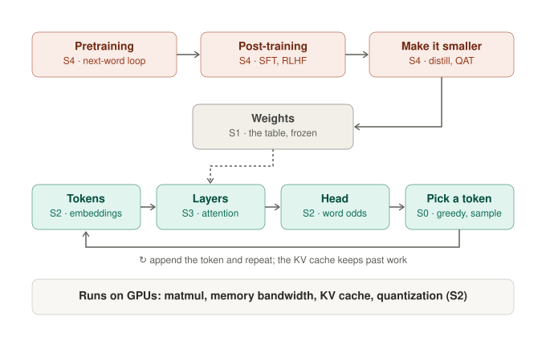

# LLM Basics

A five-session, big-picture course on how large language models (LLMs) work, written for engineers
from other fields. Many explanations use networking and electrical-engineering analogies. The
reference model throughout is **Llama 3 8B**.

## Start here

- **[Session summaries](session-summaries.md)** — the whole course in one document, with every
  figure embedded.
- **[Glossary](glossary.md)** — every acronym and term of art in one table.

## The sessions

| Session | Topic |
|---|---|
| 0 | The big picture: the whole machine is one loop that predicts the next token |
| 1 | What a model is: weights vs. code |
| 2 | The math and the hardware: tensors, matrix multiplies, embeddings, GPUs, quantization |
| 3 | The transformer: attention, layers, heads, word order |
| 4 | Where the weights come from: training, post-training, making models smaller |

## Figures

**Session 0**
- [The whole machine is one loop](figures/s0-fig1-loop.svg)

**Session 1**
- [Model file size by precision](figures/s1-fig1-sizing.svg)
- [A model is code plus weights](figures/s1-fig2-code-vs-weights.svg)

**Session 2**
- [Tensors and the safetensors file](figures/s2-fig1-tensors.svg)
- [Where Llama 3 8B's parameters live](figures/s2-fig2-param-budget.svg)
- [The embedding matrix, applied by lookup](figures/s2-fig2b-embedding-applied.svg)
- [d_model: the width of the vector stream](figures/s2-fig3-dmodel.svg)
- [Inference is one operation repeated: y = W·x](figures/s2-fig4-matmul.svg)
- [Neither dimension of W counts tokens](figures/s2-fig5-w-vs-tokens.svg)
- [The FLOP ladder](figures/s2-fig6-flop-ladder.svg)
- [Anatomy of one transformer layer](figures/s2-fig7-layer-anatomy.svg)
- [Meaning is geometry; the head is a correlator bank](figures/s2-fig8-embedding-geometry.svg)
- [How the head picks the next token (toy scale)](figures/s2-fig9-head-scoring.svg)
- [Decode is a streaming problem; the roofline](figures/s2-fig10-bandwidth-roofline.svg)
- [Prefill vs. decode on one wall clock](figures/s2-fig11-prefill-decode.svg)
- [Tracing one real request](figures/s2-fig12-request-trace.svg)
- [Why the weights are re-fetched every pass](figures/s2-fig13-why-refetch.svg)
- [The KV cache and batching](figures/s2-fig14-kv-cache-and-batch.svg)
- [Coding agents, images in, images out](figures/s2-fig15-code-and-images.svg)
- [Quantization mechanics](figures/s2-fig16-quantization-mechanics.svg)
- [The payoff of quantization](figures/s2-fig17-quantization-payoff.svg)
- [Quantization with a ruler](figures/s2-fig18-quantization-simple.svg)

**Session 3**
- [Attention: "tired" vs. "wide"](figures/s3-fig1-attention-tired-vs-wide.svg)
- [Why the last word knows everything](figures/s3-fig2-last-word-through-layers.svg)
- [Three heads, three questions](figures/s3-fig3-three-heads.svg)
- [RoPE: word order via rotating clock hands](figures/s3-fig4-rope-word-order.svg)

**Session 4**
- [Pretraining vs. inference](figures/s4-fig1-pretraining-vs-inference.svg)
- [Loss in bits vs. probability](figures/s4-fig2-loss-vs-probability.svg)
- [Backpropagation through an amplifier chain](figures/s4-fig3-backprop-chain.svg)
- [Pretraining, SFT and RLHF](figures/s4-fig4-post-training-stages.svg)
- [Distillation and quantization-aware training](figures/s4-fig5-distillation-qat.svg)
- [Rounding after training vs. QAT](figures/s4-fig6-qat-rounding.svg)
- [A 4-bit ruler](figures/s4-fig7-4bit-ruler.svg)
- [Greedy decoding's repetition loop](figures/s4-fig8-repetition-loop.svg)
- [The whole curriculum on one page](figures/s4-fig9-curriculum-map.svg)
- [Embedding, attention heads and the output head](figures/s4-fig10-embedding-layers-head.svg)
- [The MLP as a bank of pattern detectors](figures/s4-fig11-mlp-detectors.svg)
- [Prefill vs. decode](figures/s4-fig12-prefill-vs-decode.svg)
