# LLM Basics — Session Summaries

A five-session, big-picture course on how large language models (LLMs) work, written for engineers
from other fields. Session 0 gives the whole picture; Sessions 1–4 each take one piece of it:

- **Session 0** — the big picture: one loop that predicts the next token
- **Session 1** — what a model is: weights vs. code
- **Session 2** — the math and the hardware: tensors, matrix multiplies, embeddings, GPUs, quantization
- **Session 3** — the transformer: attention, layers, heads, word order
- **Session 4** — where the weights come from: training, post-training, making models smaller

Reference model throughout: **Llama 3 8B** (8.03 billion parameters; vocabulary 128,256; width 4,096;
32 layers; MLP width 14,336; 32 attention heads sharing 8 key/value heads; context window 8,192).
Figures are embedded below (sources in [`figures/`](figures/)); every acronym is defined in the
[glossary](glossary.md). Many explanations use
networking and electrical-engineering analogies.

---

## SESSION 0 — The big picture: the whole machine is one loop

- Problem: machine handling of language. Rule-based NLP (natural language processing) failed — the
  rule space is too large and too soft to hand-maintain ("hand-writing a FIB for a topology that
  shifts with every reader").
- The bet: reduce ALL of language to one task — next-token prediction. Predicting well forces a
  model to absorb grammar, facts and reasoning. (This is an empirical result, not a derivation; why
  it works this well is a genuinely open question.)
- THE LOOP: tokenize the context → one transformer pass → output head [128256×4096] scores every
  vocabulary entry → softmax → probability distribution → pick one token → append it → run again.
  One full pass (all of Session 2's FLOPs and bytes) = ONE token. A 500-token answer = 500 spins.
- Picking: greedy (argmax, deterministic) vs. sampling with a temperature — the ONLY place
  randomness enters, which is why the same prompt can give different answers.
- Chat is completion in disguise: a transcript is a document being continued. System prompts, tool
  results and retrieved documents (RAG) are just more context tokens. One loop, no second mechanism.
- Session map: S1 = the artifact (the weights), S2 = the cost of one spin, S3 = inside the box and
  why spins don't redo old work (KV cache), S4 = where the weights' values came from.
- Figure:

  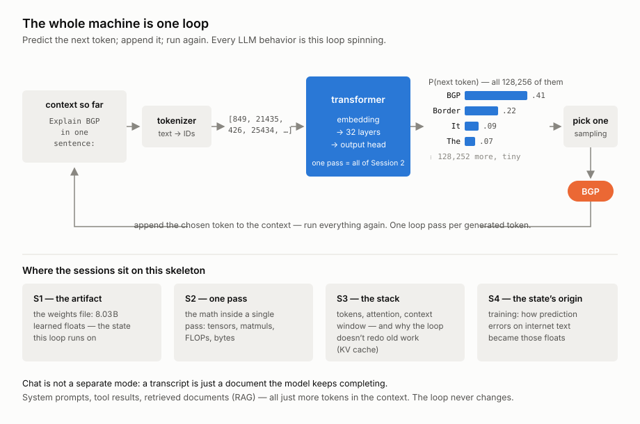

  *The whole machine is one loop: tokenize, one pass, pick a token, append, repeat*

### Session 0 Q&A, round 1 — tokens, knowledge, dense vs. MoE, what a "pass" is

- Vocabulary = 128,256 SUBWORD PIECES, not words. Built by BPE (byte-pair encoding), a frozen
  compression dictionary; the 256 byte values are the floor, so any text tokenizes and OOV
  (out-of-vocabulary) failures are impossible. Size is a designer choice (older models ~32K, GPT-4
  ~100K, Llama 3 ~128K, some up to 256K): a bigger vocabulary means fewer loop spins per sentence but
  a fatter embedding table and output head. Model + tokenizer are a locked pair.
  Side effects: tokens ≠ words (~1.3 tokens per English word; code and CJK text fragment more, so
  cost more); character-level blindness ("how many r's in strawberry") because the model sees IDs,
  not letters.
- Grammar, facts and style are not bypassed by training — the prediction objective forces them INTO
  the weights (implicit state, no rules module). FIB analogy: there is no BGP spec inside a FIB, yet
  every entry encodes its consequences. Corollary: facts are statistical pressure with no lookup and
  no NULL, so confabulation is the native failure mode — the output is fluent regardless of certainty.
- Dense vs. MoE (mixture of experts): dense = ALL non-embedding weights are applied to every token
  (7.50B multiplied; the 525M embedding table is a pure lookup, X[i] = E[id] — indexing, zero FLOPs).
  MoE = many expert MLPs per layer plus a tiny learned router that picks 1–2 per token (learned
  dispatch, not an ID lookup) → total parameters ≠ active parameters. See the embedding-lookup figure in
  Session 2 ([s2-fig2b](figures/s2-fig2b-embedding-applied.svg)).
- A "pass" = the full stack (embedding → 32 layers → head), NOT one layer. 1 pass = 1 token out.
  Prompt positions traverse together ([n×4096]); weights are fetched once and used n times. Only the
  LAST position's layer-32 vector feeds the head → softmax → sample.
- Word order: per-token lookups and matmuls are order-blind; position is injected inside attention via
  RoPE (rotary position embedding) — Session 3.
- Worth noticing: an output token may be a word FRAGMENT; the model consumes its own outputs as input
  (append → full new pass), so errors compound and there is no backtracking; and recomputing every
  old position on every pass would be quadratic waste — which is exactly the motivation for the KV
  cache.

### Session 0 Q&A, round 2 — training vs. inference, context limits, parallelism, scale

- Inference vs. training: everything above is INFERENCE (weights read-only). Training runs the
  IDENTICAL forward pass, plus a backward pass that assigns each weight its share of the error, plus a
  tiny weight update — repeated over trillions of tokens. Text is its own label (self-supervised).
  Training FLOPs ≈ 6 × parameters per token (2 forward + 4 backward). No generation loop in training —
  every position's prediction is scored simultaneously. RIB↔FIB analogy: a slow process writes the
  state, a fast process reads it. (Session 4 covers this in depth.)
- Vocabulary size ≠ length limit: rows are reusable per lookup. Stream length is bounded by the
  CONTEXT WINDOW instead (Llama 3 8B: 8,192 tokens). Since n is the free matmul dimension, the limit
  is NOT in the weight shapes; it comes from (1) the position range RoPE was trained on — a soft
  "edge of the map", (2) attention's n² compute, (3) KV cache memory ∝ n. A soft learned limit,
  enforced hard by serving systems. The vocabulary bounds the dictionary; the context bounds the slots.
- Parallelism map (per pass): the serial spine is QKV → attention core → O → MLP within a layer; the
  32 layers are strictly sequential; token N+1 waits for token N. Parallel: within each matmul
  (millions of independent MACs — the GPU's food), across positions (except inside the attention
  core), Q∥K∥V (in practice FUSED into one matmul), and across requests (batching). Depth plus the
  loop set a latency floor; throughput scales with hardware, single-stream latency mostly doesn't
  (line rate vs. propagation delay).
- Scaling a dense model ×1000 (8T parameters, 16 TB at 16-bit) — three ledgers diverge: work per
  token ~×1000 (FLOPs and bytes both ∝ parameters), latency per token ~×3–10 (it grows with depth;
  most of a 1000× increase goes into width, which parallelizes across many GPUs' combined bandwidth),
  hosting ~×1000 (200+ GPUs just to hold the weights → a rack-scale distributed system with a
  per-layer network tax).
- MoE at the same 8T: hosting UNCHANGED (all experts must stay resident — routing is per token per
  layer). FLOPs and bytes per token follow the ACTIVE parameters (~100B → ~200 GB per token vs. 16 TB
  dense), so latency ≈ that of a dense model of the active size, plus an all-to-all dispatch hop per
  layer. Every token still traverses ALL layers (MoE swaps which MLP fills a stage, never skips
  stages); attention is shared, not split into experts. Batching amortizes less well (a batch
  scatters across experts). CDN framing: provision storage for the whole catalog, pay bandwidth only
  for what each request pulls; a dense model streams the whole catalog for every request.

---

## SESSION 1 — What a model is: weights vs. code

**Covered:** model = inference code (small, generic) + weights (a large learned blob).

- Parameters = learned floating-point numbers in matrices; no symbolic rules, no fact database.
- Open weights (Llama, Mistral: a runnable binary, not reproducible) vs. true open source (OLMo: plus
  training data and training code); most "open" model licenses fail the OSI (Open Source Initiative)
  definition.
- Safetensors: a JSON header plus raw bytes. It replaces pickle files (.bin/.pt), which are an RCE
  (remote code execution) vector, and allows zero-copy mmap. GGUF is llama.cpp's format.
- Sizing: bytes ≈ parameters × bytes per parameter. At 16 bits (2 bytes): 8B ≈ 16 GB, 70B ≈ 140 GB.
  FP32 doubles that; INT8 halves it; 4-bit quarters it.
- Running a model needs more memory than the file size: activations and the KV cache come on top
  (Sessions 2–3).
- Figure:

  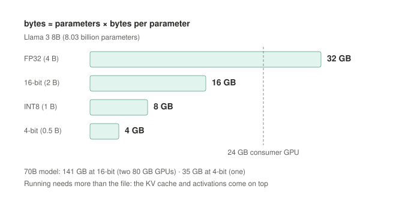

  *Model file size = parameters × bytes per parameter (Llama 3 8B)*

**Core analogy (router ↔ LLM):**

| Router | LLM |
|---|---|
| Forwarding-plane logic (fixed LPM lookup) | Inference code (fixed matmul sequence) |
| FIB contents (installed state) | Weights |
| BGP/OSPF + best-path (produces FIB) | Training (produces weights) |
| RIB → FIB compilation | Checkpoint → deployed quantized model |

Key points: the fast path is dumb (intelligence frozen into data beforehand); the slow, expensive
process (BGP ↔ training) is separate from the fast, cheap one (forwarding ↔ inference); the state is
the product (same engine + different weights = a different model).

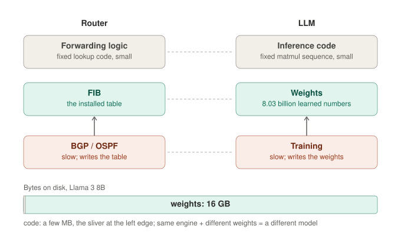

*A model is code plus weights, like a router is forwarding logic plus a FIB*

**Where the analogy breaks:**

1. FIB entries are human-readable; individual weights are not meaningful on their own
   (interpretability is an open research problem).
2. A FIB is continuously regenerated from a live RIB; weights are frozen after training
   (fine-tuning is an offline maintenance-window event, not convergence).
3. A FIB is megabytes next to the forwarding code; in an LLM the weights dominate the bytes — the
   ratio is inverted.

**Common mistake:** mapping the code to the FIB. The FIB is the weights; the forwarding logic is the
code.

### Session 1 Q&A

**Q: If weights are frozen, how do web search results shape the output?**

A: Through input tokens only. The model emits a tool call as text; an external orchestrator runs the
search and splices the results back into the context; generation resumes conditioned on them. The
weights are unchanged — this is in-context learning: training taught HOW to read, the context
supplies WHAT to read. Router mapping: context window ↔ the packet being processed (per-request data);
enrichment happens outside the fast path, in control code. Note the prompt-injection risk: fetched
content shares the token stream with user input (payload treated as control data).

**Q: What is RAG?**

A: Retrieval-augmented generation — a system pattern, not a model feature. Ingestion (offline): chunk
documents (~500–1,000 tokens) → embedding model → vectors in a vector database. Query (online): embed
the question → nearest-neighbor search (cosine similarity) → top-k chunks spliced into the prompt →
the model generates while attending over them. Solves staleness, private data, and confabulation of
specifics. CDN framing: weights = a build-time snapshot; RAG = an origin pull per request; the hard
problems live in the lookup layer. Limits: silent retrieval misses, chunking breaks cross-document
synthesis, and trust moves to the quality of the corpus.

---

## SESSION 2 — The math and the hardware

**Covered:** tensors → matmul → embeddings → GPUs and bandwidth → quantization, in five parts.

**The through-line:** a model is a fixed pile of numbers, and *using* it means dragging all of them
past a multiplier once per token. Everything in Session 2 follows from that one sentence — the
parameter budget, the two cost ledgers, why GPUs, and why quantization is the lever that matters.

**What Session 2 establishes:**

1. **Tensors** — weights are rank-2 arrays plus shape/dtype metadata; safetensors is a
   name→{dtype, shape, offset} manifest over raw bytes, so loading is an mmap, not a parse.
2. **The parameter budget** — Llama 3 8B = embedding 525M + 32 layers × 218.1M + output head 525M =
   8.03B. Per layer: attention 41.9M (19%: Q and O 16.8M each, K and V 4.2M each) and MLP 176.2M
   (81%: three matrices of 58.7M). Parameters per layer ∝ d².
3. **Matmul is the whole computation** — y = Wx is a bank of 4,096 correlators (matched filters) run
   against one input vector. W's dimensions are input/output width, never token count; positions
   never mix inside a matmul.
4. **TWO LEDGERS, and they must not be confused** — per token: `FLOPs ≈ 2 × multiplied parameters`
   (each weight used once; a MAC is 2 operations) and `bytes ≈ bytes-per-parameter × multiplied
   parameters` (stream every multiplied weight once). For Llama 3 8B at 16-bit both come to ~15 —
   15.0 GFLOPs and 15.0 GB — a coincidence of two unrelated 2's that breaks under quantization.
5. **Embeddings are geometry** — no coordinate means anything alone; meaning is relative direction,
   measured by dot product. The output head is the same correlator machinery reversed: 128,256
   stored directions scored against the stream's final state → logits → softmax → one sampled token.
6. **Decode is bandwidth-bound, not compute-bound** — intensity ≈ positions per pass, which is 1 for
   a lone decode step against an H100's demand of 295 FLOPs/byte. Speed is pure streaming time:
   8B ≈ 4.5 ms/token, 70B ≈ 42 ms/token, with the math units ~99.7% idle.
7. **Prefill and decode are the same arithmetic at different amortization** — n positions per weight
   fetch vs. 1. ~295× per-token gap; compute-bound vs. bandwidth-bound; TTFT vs. TPOT.
8. **Quantization attacks bytes per parameter**, the term every number above is multiplied by. 8-bit
   is effectively free; 4-bit is a real but usually worthwhile trade. The dequantization fee is paid
   out of the idle ALUs, so it costs no wall clock.

**Analogies used:** matched-filter bank (matmul), backplane width (d_model), forwarding plane
(inference), pipeline latency floor (depth), stop-and-wait ARQ vs. a large window (decode vs.
prefill), edge storage array vs. origin pull (HBM residency ≠ free delivery), and a cheap ruler with
15 tick marks (quantization).

**Closes the Session 1 loop:** the router table's "RIB → FIB compilation ↔ checkpoint → deployed
quantized model" row is exactly part 5. Training produces a high-precision control-plane artifact;
deployment compiles it into a lower-precision form shaped by the fast path's real constraints. The
installed state is deliberately not the authored state.

### Parts 1–2: tensors and matmul

- Tensor = n-dimensional array + shape/dtype metadata; LLM weights are almost all rank-2.
  The safetensors header = name→{dtype, shape, offsets} manifest → zero-copy mmap.
- Llama 3 8B: embedding [128256×4096] 525M + 32 × 218.1M layers + head 525M = 8.03B.
  Per layer: attention Q, O [4096×4096] 16.8M each + K, V [1024×4096] 4.2M each = 41.9M (19%);
  MLP gate/up/down 3 × 58.7M = 176.2M (81%).
- d_model = 4,096 = per-token vector width = the "bus width"; parameters per layer ∝ d².
  Distinct from: vocabulary 128,256, MLP width 14,336, context window 8,192.
- Token vs. POSITION: in "If the router drops the packet", " the" is token ID 279 at positions 1 AND
  4 — identical embedding rows at entry; the two vectors diverge as they pass through the layers.
- Matmul y = Wx: W = a bank of correlators (matched filters) applied to the same input.
  W's dimensions are in/out width, never token count; positions NEVER mix in matmuls.
- FLOP ladder: each weight is multiplied once per token → MACs = multiplied parameters (7.50B);
  a MAC = fused multiply + add = 2 FLOPs → FLOPs per token ≈ 2 × parameters (8B ≈ 15.0 G).
- Layer anatomy: [QKV → attention core (cross-position, WEIGHT-FREE) → O] + skip;
  [gate/up → SiLU → down] + skip. Interfaces pinned to d_model; internals free.
- Memory: minimum bytes per token = 2 × parameters at 16-bit (stream the weights once) → 70B ≈ 140 GB.
  Common mistake: answering 280 GB by multiplying the FLOPs and bytes ledgers together. Preview:
  bandwidth-bound → H100 ~3.35 TB/s → ~24 tokens/s ceiling for 70B; batching amortizes (part 4).
- Figures:

  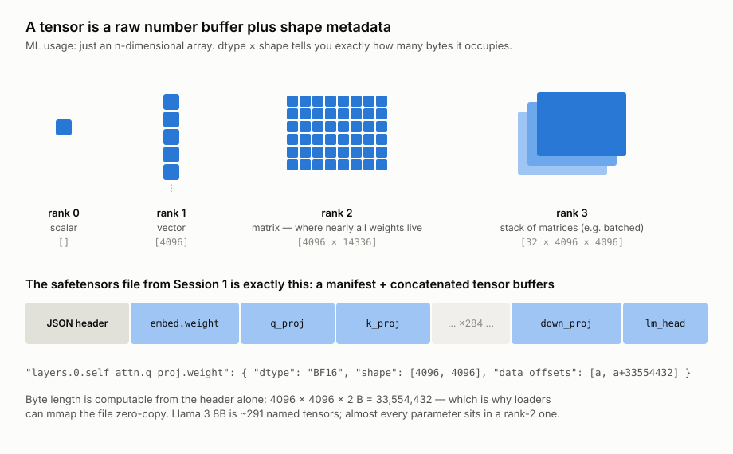

  *A tensor is a number buffer plus shape metadata; a safetensors file is a manifest plus buffers*

  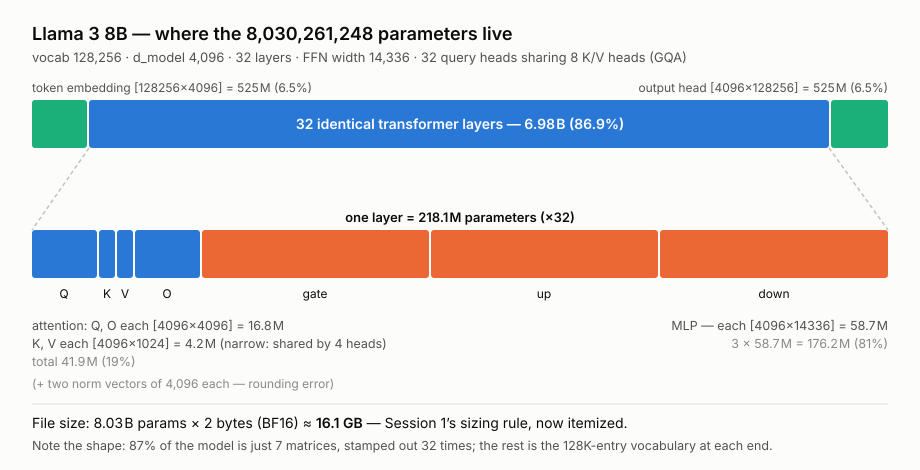

  *Llama 3 8B: where the 8.03 billion parameters live*

  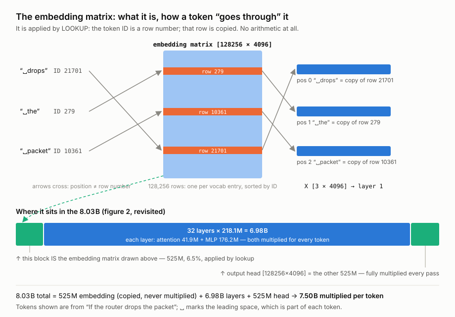

  *The embedding matrix is applied by lookup: the token ID is a row number*

  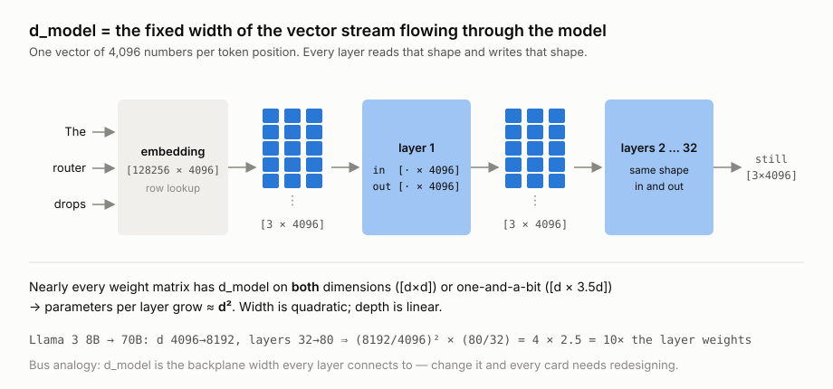

  *d_model: the fixed width of the vector stream through every layer*

  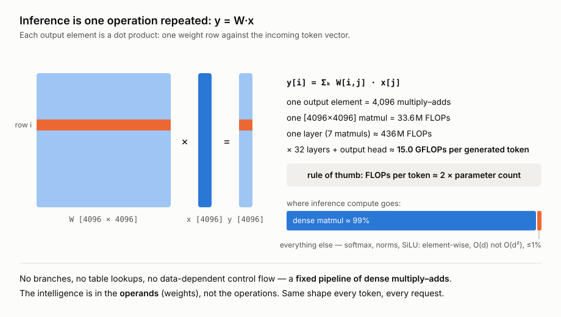

  *Inference is one operation repeated: y = W·x*

  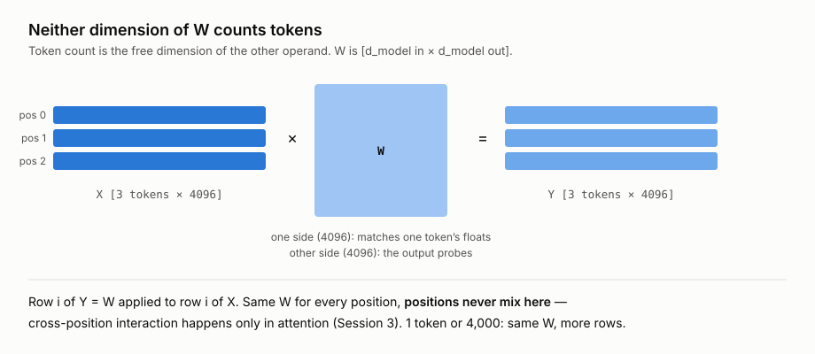

  *Neither dimension of W counts tokens*

  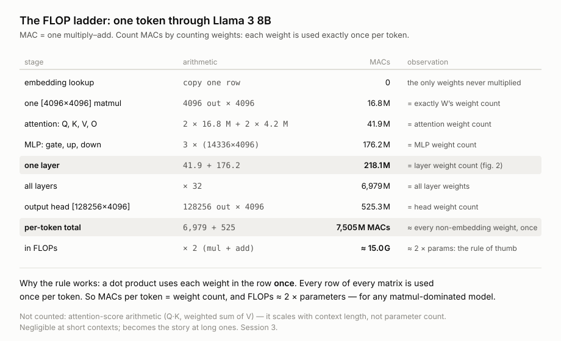

  *The FLOP ladder: one token through Llama 3 8B*

  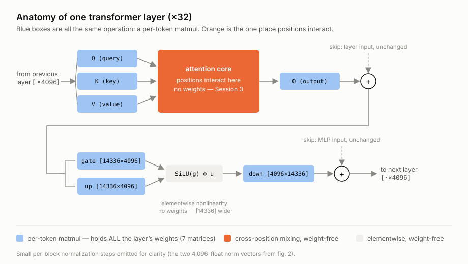

  *Anatomy of one transformer layer*

**MLP recap:**

- MLP = multi-layer perceptron (= FFN, feed-forward network). Per token, no cross-position
  interaction: [4096] → gate/up [14336×4096] → SiLU gating → down [4096×14336] → [4096], added to the
  stream.
- Holds 176.2M of each layer's 218.1M parameters → ~81% of each layer, ~70% of the whole model.
- SiLU gating is the one nonlinear step — without it, stacked matrices would collapse into one.
- Rough division of labor (a trend, not a theorem): attention = routing/data movement between
  positions; MLP = per-token processing; factual associations are largely stored in MLP weights.

### Part 3: embeddings

- Meaning is geometry: no single coordinate of E[id] means anything (echoing where the FIB analogy
  breaks in Session 1); meaning lives in relative distances and directions among rows in
  4,096-dimensional space.
- The ruler = dot product = correlation — part 2's matched filter reused as a measure:
  cos θ = a·b / (|a||b|). cos(E[router], E[switch]) is large; cos(E[router], E[cat]) ≈ 0.
- Nobody designs the geometry — the same mechanism that forces grammar into weights: interchangeable
  contexts need similar downstream treatment, and the cheapest gradient path is to make the rows
  nearby (the distributional hypothesis). Analogy: Vivaldi network coordinates (learned coordinates
  where distance ≈ RTT ↔ here, distance ≈ substitutability).
- High-dimensional room: two RANDOM 4,096-d vectors have |cos| ≈ 1/√4096 = 1/64 ≈ 0.016 — nearly
  orthogonal by default. The number of quasi-orthogonal directions grows exponentially with d, so
  4,096 dimensions hold far more than 4,096 feature axes. Directions act as features:
  king − man + woman ≈ queen (cleanest in dedicated embedding models).
- The head = the same machinery reversed: s_v = W_head[v]·h = 128,256 correlators × 4,096 MACs =
  525M MACs = 1.05 GFLOPs per token. The raw scores are LOGITS. "Predict the next token" = "which
  stored vocabulary direction best correlates with the current stream state."
- E vs. W_head: identical shape [128256×4096], OPPOSITE access — E is indexed (1 row per token,
  0 FLOPs); the head is streamed (every row scanned per generated token). Some models tie the two
  (weight tying, e.g. GPT-2); Llama 3 8B keeps them separate (525M + 525M).
- Static at entry, contextual by exit: an embedding row is only a starting coordinate ("bank" in the
  river and finance senses enters identical; the layers relocate it). The mechanism is Session 3.
- RAG tie-back to Session 1: vector-database nearest-neighbor search is this same dot-product
  machinery at catalog scale, run by a separate sentence-embedding model.

**Part 3 Q&A:**

- h (the last slot after 32 layers) = a LOSSY, task-directed compression of the ENTIRE context into a
  fixed 4,096 floats (~8 KB at 16-bit), regardless of context length — a digest for prediction, not
  an archive. If the head saw only the last TOKEN, every context ending in "the" would produce the
  same distribution.
- The prompt pass computes ALL positions' layer-32 vectors; only the last feeds the head. The others
  aren't wasted: their K and V byproducts are what the KV cache keeps. Training DOES score every
  position simultaneously.
- Toy head walkthrough (d = 4, vocabulary = 5): logits [4, 2, 1, 0, −1] → e^s = [54.6, 7.39, 2.72,
  1.00, 0.37] → P = [.826, .112, .041, .015, .006]. Because exp is monotonic, argmax(logits) =
  argmax(P), so softmax is wasted work under greedy decoding. Softmax still exists because:
  (1) sampling needs a lottery, not a ranking — the odds follow logit DIFFERENCES, not order (a gap of
  4 → 2 gives 7.4:1; 4 → 3.9 gives ~1.1:1, with the same ranking); (2) training needs differentiable
  probabilities for the cross-entropy loss (argmax has no gradient) — Session 4.
- Sampling mechanics = inverse transform: stack the P segments on the unit interval and throw ONE
  uniform random draw per loop spin — the machine's entire stochastic budget. Temperature:
  P ∝ e^(s/T); T → 0 collapses to greedy, high T flattens the distribution.
- "What got picked in the toy?" Nothing, until a decoding rule is chosen. Greedy → "packet" always;
  sampling at T = 1 → "packet" in about 5 runs out of 6.
- Ledger: softmax over 128K numbers ≈ 5×10^5 FLOPs vs. 525M MACs for the logits — all the cost is
  in the correlator bank.
- Why greedy decoding degenerates into repetition loops: Session 4.
- Figures:

  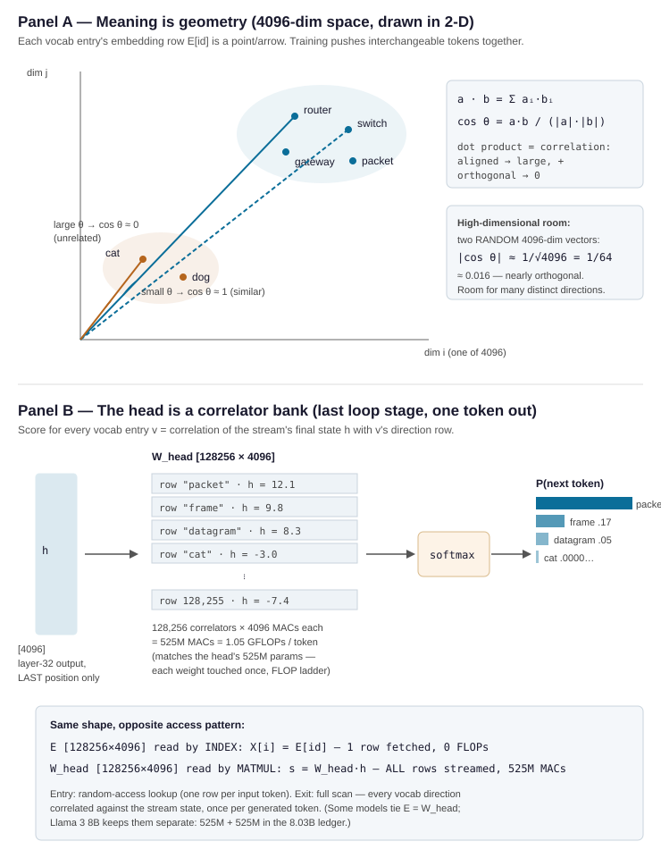

  *Meaning is geometry; the output head is a correlator bank*

  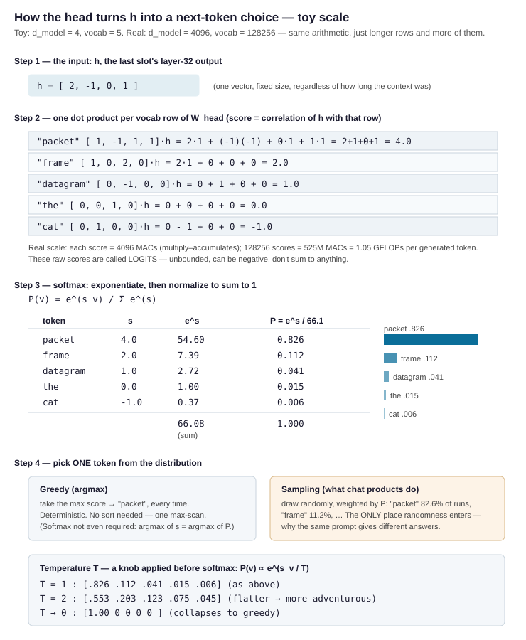

  *How the head turns h into a next-token choice (toy scale)*

### Part 4: GPUs and the bandwidth wall

- Method in one line: compare the WORKLOAD's FLOPs-to-bytes ratio against the MACHINE's — an
  impedance-matching problem. The workload side = ARITHMETIC INTENSITY (FLOPs performed per byte
  fetched).
- Why a GPU: a CPU is a latency machine (few complex cores, speculation, branchy code); a GPU is a
  throughput machine (tens of thousands of simple ALUs plus tensor cores that consume matrix tiles)
  PLUS HBM — DRAM stacked on-package with a very wide bus. Matmul is millions of independent,
  branch-free MACs: the GPU's food. "Backplane width" made literal.
- H100 balance point: 989 TFLOP/s (16-bit) ÷ 3.35 TB/s (HBM3) ≈ 295 FLOPs per byte fetched. Below
  that ratio the ALUs starve.
- Decode at batch 1: 2P FLOPs against 2P bytes → intensity = 1 vs. the machine's 295, a ~300×
  mismatch on the bandwidth side. Speed = pure streaming time:
    8B :  15 GB ÷ 3.35 TB/s ≈ 4.5 ms/token → ~220 tokens/s
    70B: 140 GB ÷ 3.35 TB/s ≈  42 ms/token →  ~24 tokens/s
  (For Llama 3 8B the file is 16 GB, but the 1 GB embedding table is looked up, not streamed, so
  ~15 GB moves per token.) ALU utilization ≈ 0.3% — a single-stream LLM is a memory pump with an idle
  math unit attached. The line rate is the pipe's, not the forwarding engine's.
- ROOFLINE: attainable FLOP/s vs. intensity, log-log; a slanted roof (bandwidth × intensity) meets a
  flat roof (peak compute) at the ridge, intensity ≈ 295. Whichever roof is overhead is the bottleneck.
- Batching: B requests share ONE weight stream → intensity ≈ B. Throughput scales roughly linearly up
  to the ridge; per-user latency barely moves (the same stream time whether 1 or 64 ride it). Your
  request is subsidized by strangers sharing the stream (CDN: one origin pull, many concurrent
  viewers).
- Prefill vs. decode: prefill's intensity ≈ n (positions traverse together), so a 2,048-token prompt
  = 31 TFLOPs ÷ 989 TFLOP/s ≈ 31 ms TOTAL, compute-bound; decoding 2,048 tokens = 2,048 × 4.5 ms ≈
  9.2 s, bandwidth-bound. A ~295× per-token gap → a fast "read" and a slow drip.
- Hierarchy cliff: HBM 3.35 TB/s vs. host DRAM over PCIe ≈ 64 GB/s (50×). Weights must be RESIDENT
  in HBM; VRAM capacity (not compute) decides what you can run at all.
- Hook to part 5: everything scales with BYTES PER PARAMETER. 16-bit → INT8 halves stream time and
  residency. Quantization attacks the binding ledger directly.
- Figure:

  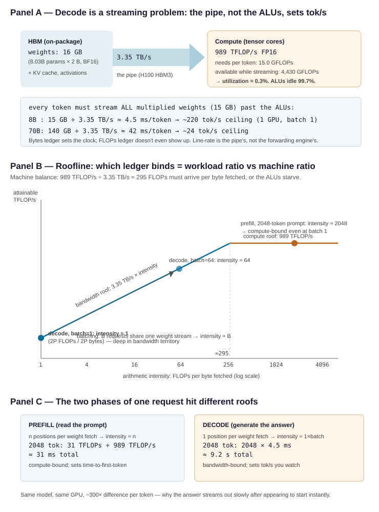

  *Decode is a streaming problem; the roofline shows which ledger binds*

**Part 4 Q&A:**

(1) "Articulate prefill vs. decode."
- Definition: same arithmetic, same weights; the ONLY difference is how many token positions ride
  along with each weight fetch. Prefill: n known tokens enter as [n × 4096]; W is fetched once and
  used n times. Decode: [1 × 4096]; W is fetched again for one position.
- The crux: decode's serialization is a DATA DEPENDENCY, not a missing optimization — position 2,049's
  input IS position 2,048's sampled token. No hardware removes it. Prefill's parallelism is free only
  because the prompt already exists.
- Per token: prefill 31 ms ÷ 2,048 = 0.015 ms vs. decode 4.5 ms → a ratio of ≈ 295×.
- NETWORKING SHAPE: prefill = a bulk transfer with a large window; decode = STOP-AND-WAIT with a
  window of 1. Stop-and-wait ARQ (automatic repeat request) cannot fill a fat pipe — not because the
  link is slow, but because one unit is in flight and the next isn't formed yet. The remedy is the
  same in both worlds: don't buy a faster link, MULTIPLEX MORE FLOWS. Batching is that multiplexing.
- Prefill computes ALL n positions' layer-32 vectors; only the last feeds the head. The rest aren't
  wasted — their K and V populate the KV cache. Prefill BUILDS the cache; decode reads it and extends
  it by one entry per pass.
- Practice: TTFT (time to first token) ← prefill; TPOT (time per output token) ← decode;
  total = TTFT + m × TPOT. Input tokens are priced below output tokens because of this gap. Batching
  lifts decode only. Systems answers to the two phases competing for one GPU: chunked prefill,
  continuous batching, and prefill/decode disaggregation (≈ splitting a CDN's ingest tier from its
  edge-serving tier).
- Figure:

  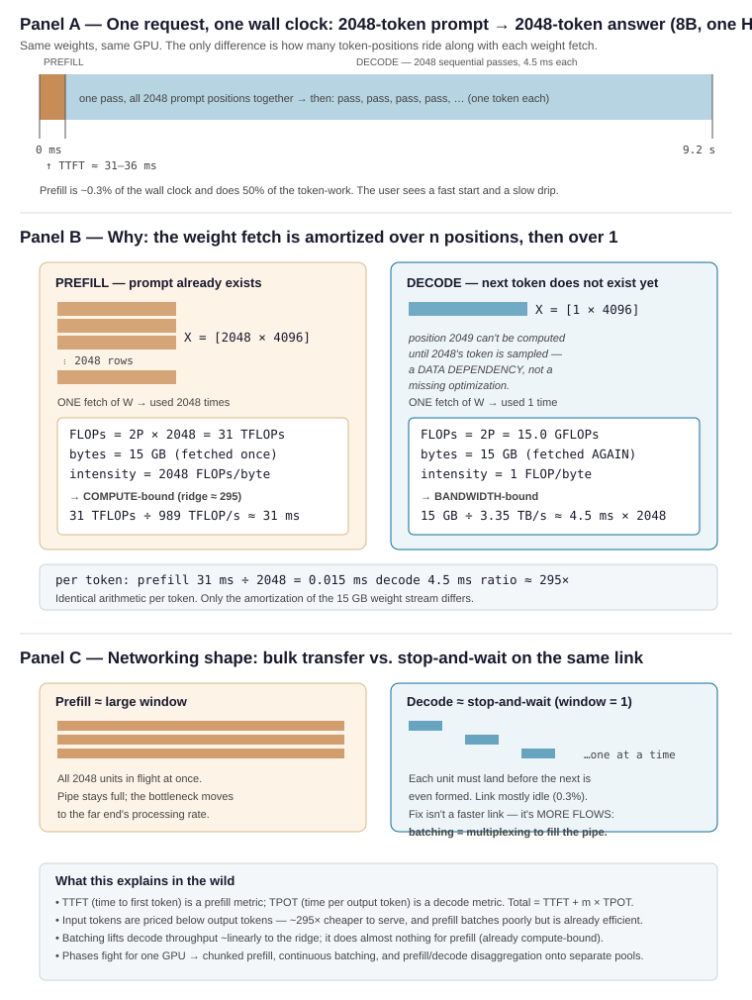

  *Prefill vs. decode: one request on one wall clock*

(2) "When does each take place? Trace 'how is the weather today'."
- Step 0: the 5 words become ~30 tokens once the chat template wraps them (begin-of-text marker,
  system prompt, role headers). Chat-is-completion made concrete.
- Step 1, PREFILL — one pass ≈ 4.5 ms: all ~30 positions together → KV cache for those positions +
  the last position's h → head → first token. That token appearing = TTFT.
- Step 2, DECODE — 45 passes × 4.5 ms ≈ 202 ms (98% of the request): each pass carries ONE position,
  attends over the cached entries, and appends. An end-of-sequence token is sampled → halt; the
  request's state is discarded.
- Important qualifier: "prefill is compute-bound" is FALSE for short prompts. Prefill's intensity ≈ n
  and the ridge is 295, so the crossover is n ≈ 295 TOKENS. At n = 30: 450 GFLOPs of work, but still
  one full 15 GB weight stream → 4.5 ms, bandwidth-bound, ALUs ~10% busy. A 30-token prompt costs the
  same wall time as a 295-token one — prefill's first ~300 tokens are effectively FREE. Only pasted
  documents, RAG chunks, long transcripts and code files cross the ridge. Correct statement: prefill
  is compute-bound for LONG prompts; the invariant is the amortization ratio, not the phase name.
- Multi-turn: the model is stateless; turn 2 prefills the WHOLE transcript again (30 + 45 + 7 ≈ 82
  tokens). Prefix caching keeps the unchanged 75 tokens' K and V → only the 7 new tokens are prefilled.
  This is the "cache read" line on an API bill. CDN: the transcript prefix is a cacheable object keyed
  by content; only the delta is an origin fetch.
- The boundary in one line: NOT "prompt vs. answer" but "already known vs. not yet sampled."
- Figure:

  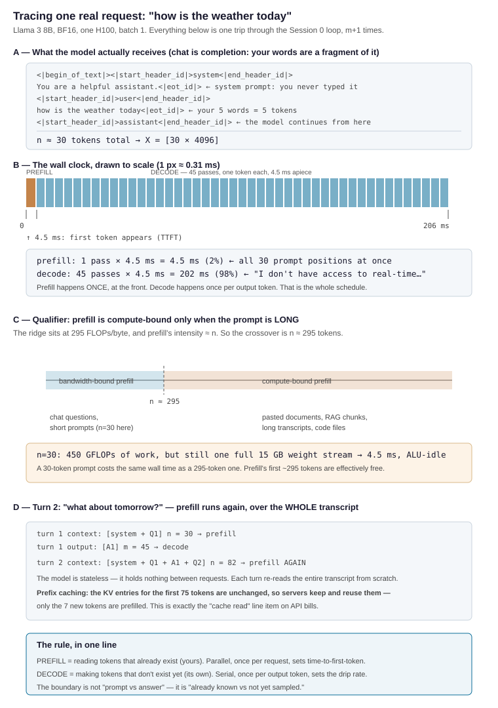

  *Tracing one real request: "how is the weather today"*

(3) "The weights are already loaded in HBM and reused across prefill and decode, so decode should
    cost almost nothing." — Wrong, and the most important misconception in this part.
- The conflation: "resident in HBM" ≠ "available to the ALUs." HBM is the FAR SIDE of the bottleneck,
  not a cache in front of it. Residency is paid once at model load (it buys you not crossing PCIe);
  delivery to a register is the 3.35 TB/s traffic, per multiply, per pass.
- Capacity: H100 on-chip SRAM ≈ 50 MB usable (registers ~34 MB, L1/shared ~30 MB, L2 50 MB) vs.
  15 GB of streamed weights = 300×. You can hold 0.33% of it on-chip. One LAYER = 436 MB; the largest
  single matrix (MLP down) = 117 MB > the entire L2. Not one matrix stays resident.
- Reuse distance: between pass N and pass N+1 needing layer 1, 15 GB flows through a 50 MB cache —
  evicted 300× over. A textbook capacity miss with zero temporal locality; no replacement policy
  survives it.
- Deeper: at batch 1 there is no reuse even WITHIN a pass. The FLOP ladder says each weight is
  multiplied EXACTLY ONCE per token: fetch 2 B → 1 MAC → no further consumer. "Intensity = 1" IS the
  formal statement that no reuse exists. A cache can only help a byte that is read more than once.
- The instinct "compute once, reuse" is RIGHT — but it applies to the KV cache, not the weights. The
  asymmetry: the weights are the same for every token and all of them are needed every pass (no
  per-token value to cache); KV entries are per-position values already computed, so caching them
  removes genuinely redundant work. Same bytes + a new input vector = new work, not redundancy —
  bandwidth is the price of admission.
- CDN framing: an object resident on an edge server's storage array still crosses the array at array
  bandwidth for every client stream. Residency eliminated the ORIGIN fetch, not the SERVING fetch. A
  15 GB working set against a 50 MB page cache = zero hit rate by construction.
- Figure:

  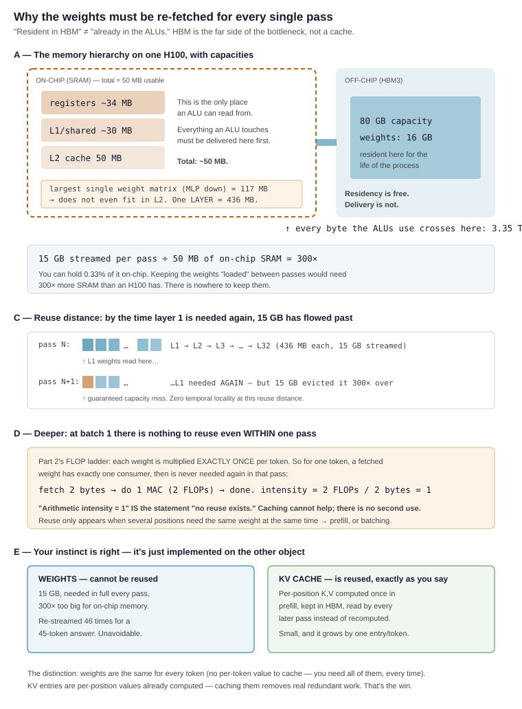

  *Why the weights must be re-fetched for every pass*

(4) "So a fetch = 2 B from HBM into a register at 3.35 TB/s for the ALU, and reuse applies to
    prefill, not decode?"
- The first half is right (the path is HBM → L2 → L1/shared → registers, moving in cache lines and
  tiles rather than individual 2-byte reads; the accounting is unchanged).
- The second half needs correcting: reuse is NOT prefill-only. It tracks how many token positions ride
  in the pass — decode gets it through BATCHING. ONE LAW: intensity ≈ POSITIONS PER PASS.
    prefill n = 2,048 → 2,048 | decode batch 64 → 64 | decode alone → 1
  Prefill and decode are not two rules; decode at batch 1 is the degenerate case. Physically the reuse
  happens inside the matmul: a W tile is staged into shared memory once, then multiplied against every
  input row present.

(5) "Is there batching for MY request? Where is the KV cache generated and placed?"
- Batching never combines your own tokens (serial dependency); the batch dimension is REQUESTS. At
  each 4.5 ms step the server gathers every active request's next position into [B × 4096] — one
  weight stream serves all B. It does NOT speed up your answer (~4.5 ms per token regardless); it buys
  the operator throughput and you a lower price. CONTINUOUS BATCHING: the batch is re-formed every
  step — users join and leave mid-flight, and a prefill can ride along. Running locally (llama.cpp,
  one user), batch = 1 genuinely.
- The KV cache is GENERATED inside every layer at the K and V projections: K = W_k·x and V = W_v·x
  are kept rather than discarded (Q is used once and thrown away; future tokens must attend over this
  position). 32 layers × 2 vectors = 64 vectors written per position, each 1,024 numbers wide.
- It is PLACED in HBM alongside the weights — far too big for the 50 MB of SRAM, and it is
  per-request state. Allocated at request start, grows by one entry per token, freed at completion.
- SIZE: 32 layers × 2 × 1,024 × 2 B = 128 KB PER TOKEN. K and V are only 1,024 wide because of GQA
  (grouped-query attention): Llama 3 8B's 32 query heads share 8 K/V heads. Without GQA they would be
  4,096 wide — 512 KB per token, 4× more. The example request: 75 tokens = 9.4 MB = 0.06% of the
  pass's traffic — a rounding error at chat-turn scale.
- BUT this is the scale constraint: the weights are fixed at 16 GB, while KV caches scale with
  batch × context. At 2,048 tokens of context each request holds 0.27 GB:
    max batch at 2,048 context = (80 − 16) GB ÷ 0.27 GB ≈ 238 requests   (without GQA: ≈ 60)
  KV CACHE CAPACITY — not compute, not weight bandwidth — CAPS THE BATCH, and therefore caps how far
  the weight stream can be amortized; longer contexts lower the cap further. This ceiling is exactly
  why GQA exists. Servers store the cache in fixed-size blocks (PagedAttention), like OS
  virtual-memory paging, so fragmentation doesn't waste the scarce resource.
- The cache is per SEQUENCE, not per user (two tabs = two caches); conversely, a shared prefix (the
  system prompt, identical for all users) can be computed once and shared.
- WHAT THE KV CACHE ACTUALLY BUYS: without it, each decode step would re-run the pass over all L prior
  positions → 2P·L FLOPs, with weight bytes unchanged. Recompute time = 15.2 µs × L vs. the 4.5 ms
  bandwidth floor:
    L = 75    → 1.1 ms  < 4.5 ms  (hidden entirely behind the weight stream — saves nothing)
    L = 295   → 4.5 ms  = crossover (the ridge again, necessarily — same ratio)
    L = 2,048 → 31 ms   > 4.5 ms  (~7× slower without the cache)
  So for a short chat turn the cache saves almost no wall clock. Its real value is the asymptote:
  generating m tokens is O(m) with the cache and O(m²) without. It is a memory-for-compute TRADE:
  spend HBM capacity (the thing that caps the batch) plus a small read, to buy back O(L) recompute —
  which only pays off past the ridge.
- Figure:

  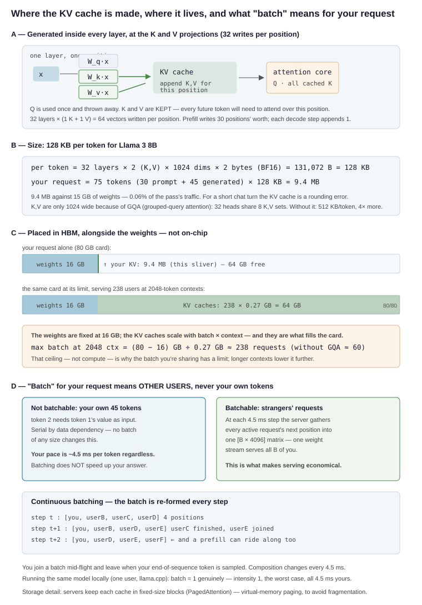

  *Where the KV cache is made and lives, and what batching means*

**Side topic: coding agents and image generation**

- CODING AGENTS: the SAME model and the SAME loop — code is just text to the tokenizer; there is no
  compiler, parser or symbol table inside the model. What differs is an OUTER LOOP: the model emits a
  tool call as ordinary text → the harness executes it → the result is appended → a NEW PREFILL over
  the grown context → more decode. Two nested loops; the model only ever runs the inner one.
  Consequences: the context grows monotonically, so agents are extremely prefill-heavy (often 10–100×
  more input than output tokens) and lean hard on prefix caching; long contexts push prefill past the
  ridge, so both phases are exercised; and the model has NO VERIFIER — correctness is established
  only by the outer loop actually running the code. Confabulation applies to APIs and function
  signatures exactly as it does to facts.
- IMAGE AS INPUT: still the same loop, but the picture becomes EMBEDDING VECTORS, not tokens. Text:
  characters → tokenizer → ID → embedding-table lookup → [4096]. Image: pixels → vision encoder →
  [4096] DIRECTLY, skipping both the tokenizer AND the embedding table — it enters one stage later,
  with no ID and nothing discrete in its path. From layer 1 the arithmetic is identical, though
  delimiter tokens bracket the region and the encoder's outputs land in characteristic regions of the
  space that training taught the layers to handle. Cost: several hundred to ~1,500 positions per
  image — a screenshot can cost more prefill than a page of text.
- IMAGE AS OUTPUT: a DIFFERENT model and a different algorithm, invoked as a tool. Diffusion: start
  from Gaussian noise; ~20–50 steps, each predicting noise to remove, conditioned on the prompt. NOT
  autoregressive — the whole canvas is refined at every step; no vocabulary, no softmax over discrete
  choices; the output is continuous (usually a latent, decoded by a VAE at the end). The step count is
  fixed by a schedule, not by content. The one shared idea is part 3's: the prompt becomes a TEXT
  EMBEDDING injected via cross-attention.
- WHY IN BUT NOT OUT — derived from the head: the exit is [128256 × 4096] and all 128,256 rows are
  TEXT pieces. Softmax over that can only ever emit a text fragment; THERE IS NO IMAGE-SHAPED EXIT.
  Not a policy choice — the output layer is the wrong shape. Hence delegation. Corollary: give the
  model a visual vocabulary (quantize image patches, add rows to the head) and the same loop emits
  images natively — the autoregressive image approach. Architecture unchanged; vocabulary and head
  changed.
- LEDGER CONTRAST: text decode = 1 position per pass, intensity ≈ 1, BANDWIDTH-bound, ALUs ~0.3% busy,
  steps = answer length. A diffusion step = ~16,000 latent positions per pass, intensity in the
  thousands, COMPUTE-bound, ALUs saturated, steps fixed. A text model wants bandwidth; an image model
  wants FLOPs. Same silicon, opposite bottleneck — which is why "GPU-hours" is nearly meaningless
  without naming the workload.
- Caveats: autoregressive image generation exists, unified multimodal models blur the split, and the
  exact architecture of commercial image products is generally not published.
- Figure:

  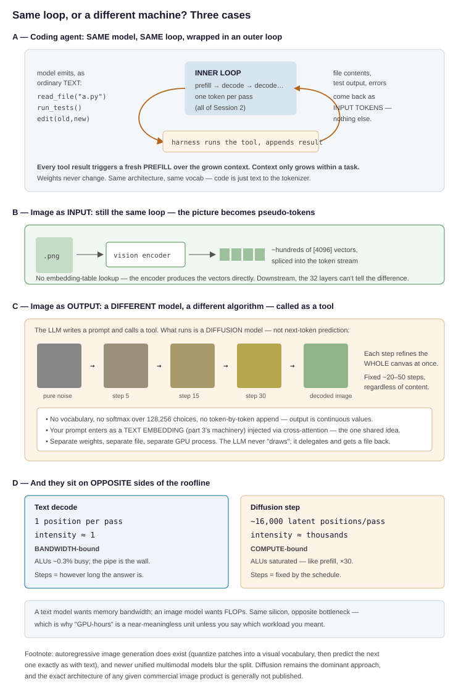

  *Same loop or a different machine: coding agents, images in, images out*

### Part 5: quantization

**The idea in one sentence:** store each weight using fewer bits by rounding it to a coarse grid,
keeping one ordinary float per group to record how coarse. It is deliberate rounding, not
compression — there is no decompressor, and the discarded precision never comes back.

- Mechanics (symmetric integer quantization):
    `s = max|w| / levels`  (levels = 127 for INT8, 7 for INT4) — the SCALE, one float per group
    `q = round(w / s)`     — what is stored: a small signed integer, the "tick count"
    `ŵ = s · q`            — DEQUANTIZE; error bounded by half a step, |w − ŵ| ≤ s/2, permanently
- Worked by hand on four weights [0.8, −0.3, 0.5, −0.6] at INT4: s = 0.8/7 = 0.114 →
  q = [7, −3, 4, −5] → ŵ = [0.800, −0.343, 0.457, −0.571]. Storage: 8 B → 4 B here, but 3.8×
  (128 B → 34 B) for a realistic group of 64, because one scale spread over more weights makes its
  own cost vanish. This is why groups are 64, not 4.
- The scale comes from the group's MAXIMUM — the whole reason outliers hurt (below), and the whole
  reason activations are harder than weights (weights are known in advance; activations are not
  known until a request arrives).

**Why it is acceptable — three independent reasons:**
1. Precision needed to INTEGRATE is not precision needed to REPORT. FP16's 10 mantissa bits exist to
   accumulate gradient updates of ~1e-5 relative over trillions of steps; inference only reads the
   settled value. (EE framing: a high-resolution ADC to integrate a drifting signal; far fewer bits
   to report the result.)
2. The rounding error is INCOHERENT. Over a 4,096-term dot product, independent zero-mean errors
   partly cancel — they grow as √n, and so does the signal — so the output's relative error stays
   comparable to the weights' rather than amplifying. Across 32 layers it compounds only ~√32.
3. Trained minima are flat, and the network was optimized amid noise anyway (SGD sampling, dropout,
   BF16 arithmetic). Small weight perturbations are the conditions it was trained under.

**The payoff — the part-4 ledgers, every number multiplied by bytes per parameter (Llama 3 8B, one
H100, batch 1):**

    format   B/param   streamed   stream time   tokens/s ceiling
    16-bit     2.0      15.0 GB     4.48 ms        ~223
    INT8       1.0       7.5 GB     2.24 ms        ~446     ← 2×
    INT4       0.5      3.75 GB     1.12 ms        ~893     ← 4×

  Linear with no asterisk, because decode time IS the weight stream. On a 70B model: 16-bit 140 GB →
  2 × 80 GB cards, 42 ms/token; INT4 35 GB → ONE card, 10.4 ms/token, with 45 GB spare for KV caches
  and the per-layer inter-GPU network tax gone entirely. The same lever at the small end: 8B at INT4
  ≈ 4 GB fits a laptop GPU — this is why local LLMs exist at all.

**THE KEY INSIGHT (the real payoff of the part-4 roofline):** dequantization costs ~1 FLOP per weight,
so INT4 decode moves from 15.0 to ~22.5 GFLOPs per token while bytes fall from 15.0 to 3.75 GB —
arithmetic intensity 1 → 6.0 against a ridge of 295. The ALUs were 99.7% idle, so the unpacking is
paid out of idle capacity and costs NO WALL CLOCK. Utilization goes 0.3% → 2.0%: still overwhelmingly
bandwidth-bound, just with a quarter of the pipe load. (Maximizing utilization was never the goal;
less wall clock per token was.)

**Which quantization helps which phase** — follows directly from the above:
- WEIGHT-ONLY (W4A16, W8A16): weights stored narrow, unpacked to 16-bit; the matmul still runs at
  16-bit. Fixes stream time and residency → speeds up DECODE; does NOT help prefill (already
  compute-bound, and the dequantization work makes it marginally worse). Easy: weights are
  well-behaved and known offline. The standard for local, single-user deployment.
- WEIGHT + ACTIVATION (W8A8, FP8): both operands narrow, so the matmul itself runs on tensor cores at
  ~2× the 16-bit rate (H100: ~1,979 vs. ~989 TFLOP/s) → also speeds up PREFILL. Hard, because of
  activation outliers. The standard for high-throughput serving. The notation reads literally:
  W = weights, A = activations. A tensor core needs BOTH operands narrow to use its fast path, so
  shrinking one side alone buys bytes but not FLOPs.
- Third ledger: quantize the KV cache too. INT4 weights + INT8 KV lift the batch ceiling at 2,048
  context from ~238 to ~566 requests — 2.4× more amortization of the weight stream, on top of the 4×
  from the weights.

**Caveat on "4-bit":** it is never exactly 4 bits. INT4 plus one 16-bit scale per group of 64 is
4 + 16/64 = 4.25 bits per weight, or ~4.5 with a zero-point.

**Formats:** FP32 4 B · FP16/BF16 2 B · FP8 (E4M3/E5M2) 1 B, with native tensor-core support from the
H100 · INT8 1 B · INT4/NF4 0.5 B · 2-bit and ternary remain research with real degradation. Two
families, which differ in kind: smaller FLOATS (FP8, FP4 — self-contained, no scale) vs. INTEGERS
plus a shared scale (INT8, INT4). MXFP4 is a hybrid: tiny 4-bit floats with a shared block scale.

**Quality, approximately and method-dependently:** 8-bit weight-only is effectively lossless; 6-bit
negligible; 4-bit with good methods small but measurable; 3-bit noticeable; 2-bit severe. The
practical consequence: AT A FIXED MEMORY BUDGET, A BIGGER MODEL AT LOWER PRECISION BEATS A SMALLER
MODEL AT HIGHER PRECISION — 70B at 4-bit > 13B at 16-bit. Quantization changes which model you
should run, not merely how you store one.

**Two routes:** PTQ (post-training quantization) — round the finished weights, calibrating on a few
hundred samples; minutes to hours; what nearly everyone does. QAT (quantization-aware training) —
simulate the rounding during training so the network learns weights that tolerate it; better at very
low bit widths; costs a training run (Session 4).

- Figures (the ruler version, the last one, is the simplest entry point):

  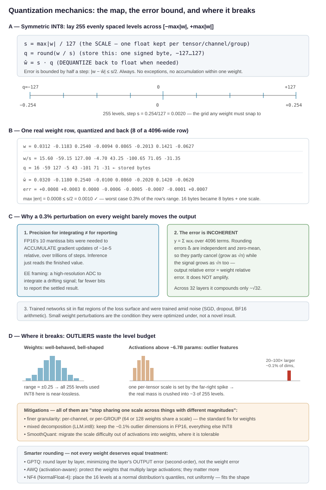

  *Quantization mechanics: the map, the error bound, and outliers*

  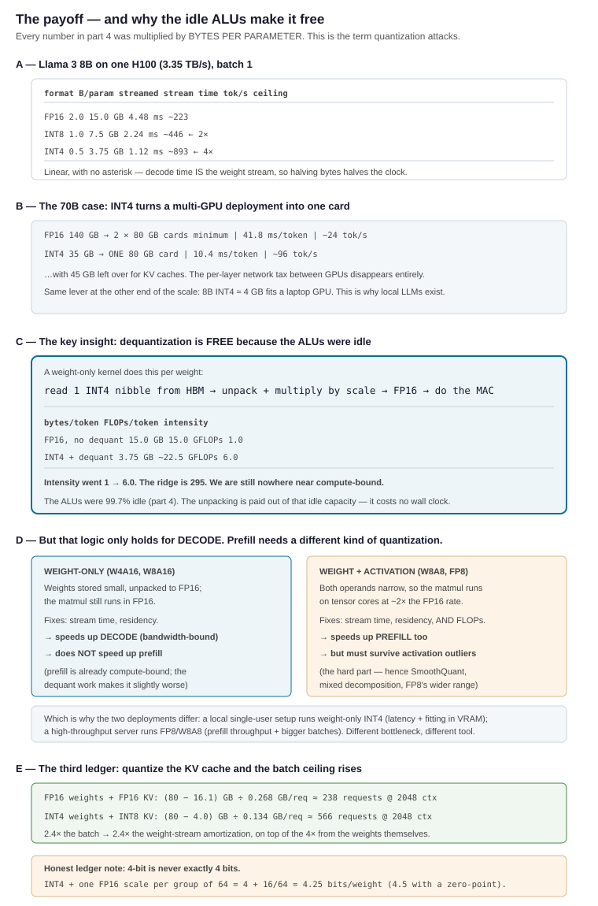

  *The payoff of quantization, and why dequantization is free*

  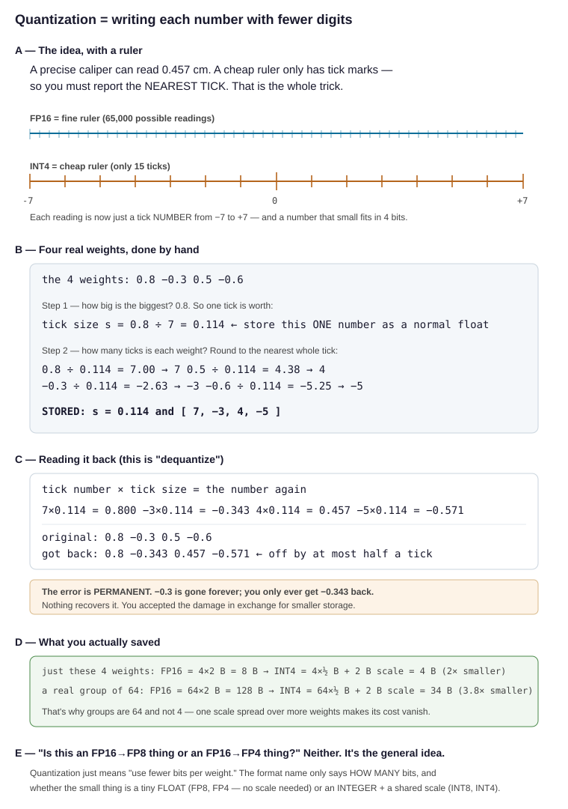

  *Quantization with a ruler: the simplest version*

#### Part 5, optional depth (beyond basics; skip on a first read)

- Outliers are the one real failure mode. Weight distributions are bell-shaped and narrow, so a
  uniform grid is well spent. ACTIVATIONS are not: above roughly 6.7B parameters, ~0.1% of feature
  dimensions develop activations 20–100× larger than the rest. One shared scale set by that spike
  crushes the real mass into a handful of levels. Concrete demo: the group
  [0.8, −0.3, 0.5, −0.6, 20.0] gives s = 20/7 = 2.857, and all four genuine weights round to tick 0.
  The information is simply gone.
- Mitigations, all variations on "stop sharing one scale across different magnitudes": finer
  granularity (per channel, or per GROUP of 64/128 — the standard fix); mixed decomposition
  (LLM.int8 — keep the outlier dimensions at 16-bit); SmoothQuant (migrate the scaling difficulty out
  of activations into weights, where it is tolerable).
- Smarter rounding, since not every weight deserves equal treatment: GPTQ (round layer by layer,
  minimizing the layer's OUTPUT error, second-order, so later weights compensate for earlier
  rounding); AWQ (activation-aware — protect the weights that multiply large activations); NF4
  (NormalFloat-4 — place the 16 levels at a Gaussian's quantiles rather than uniformly, matching the
  shape of what is stored).
- Per-weight error arithmetic (group of 64, weights ~N(0, σ), group max ≈ 2.7σ, uniform error
  std = s/√12): FP16 ≈ 0.05%; INT8 s = 0.021σ → ≈ 0.6%; INT4 s = 0.386σ → ≈ 11%. So INT4 is ~200× less
  precise than FP16. The dividing line is empirical: ~0.6% sits INSIDE the noise the network was
  trained amid (hence free); ~11% sits OUTSIDE it. Consequence: naive round-to-nearest INT4 genuinely
  degrades a model, and GPTQ/AWQ/NF4 with small groups are MANDATORY at 4 bits while unnecessary at 8.
  It is also why the two halvings are not equivalent — 16 → 8 mostly discards FP16's unused dynamic
  range (5 exponent bits spanning 1e-5…65504, for weights living in ±0.3), whereas 8 → 4 cuts into
  signal.
- What finally saves 4-bit is that the output is a DISCRETE choice: what matters is whether the
  argmax over 128,256 logits flips, and the winner usually leads by a margin. Usually. The residual
  damage shows up most on long reasoning chains (one flipped token derails everything downstream) and
  on precise recall of rare facts; chat quality often feels unaffected while multi-step arithmetic
  and code are not.

**Part 5 Q&A:**

- "Bytes per token and FLOPs per token are both ~15 — the same thing?" No: 15.0 GB vs. 15.0 GFLOPs
  are different units counted on different ledgers. The match comes from TWO UNRELATED 2's: 16-bit
  happens to be 2 bytes, and a MAC happens to be 2 operations. Proof that it is a coincidence: at
  INT4 the bytes fall to 3.75 GB while the FLOPs stay at 15.0 G. (The 16 GB file is larger than the
  15 GB streamed per token because the 1 GB embedding table is read by lookup, not streamed.)
- Embedding table refresher: E = [128256 × 4096] = 525M parameters, one row per vocabulary entry,
  read by INDEX (X[i] = E[token_id]) — array indexing, no multiply, zero FLOPs. The head is also 525M
  parameters with the same shape, but it is read by MATMUL (all 128,256 rows streamed per token). Per
  token the embedding contributes one ~8 KB row out of a 1.05 GB table.
- "So dequantization uses extra compute to recover the data lost in the reduced bits?" No:
  dequantization recovers the FORMAT, not the PRECISION — ŵ ≠ w forever, and nothing downstream
  restores it. The trade is: accept a permanent small error, pay a trivial unpacking fee. Nor does it
  "max out the idle compute": utilization goes 0.3% → 2.0%, nowhere near the ridge; the point is
  headroom, not balance.
- Ridge refresher: 295 is purely the machine's own ratio, 989 TFLOP/s ÷ 3.35 TB/s = 295 FLOPs per
  byte. Nothing about LLMs is in it; a different GPU has a different ridge.
- "Shouldn't the precision loss be very significant at 25% of the storage?" Yes, at 4 bits it is
  real: see the per-weight error arithmetic above (INT4 ≈ 11%, ~200× worse than FP16). The honest
  position: 8-bit is free; 4-bit is a real trade that is usually worth taking because it buys
  parameter count you could not otherwise fit.
- "Is this tied to FP16→FP8, or FP16→FP4?" Neither — quantization is the general idea "use fewer bits
  per weight." A format name only states how many bits, and whether the small thing is a tiny float
  or an integer plus a scale.
- "Does one need to know the maximum weight value to set the tick size?" Yes — scan the group, take
  max|w|, divide by the level count. Easy for weights (sitting in a file, scanned once offline); hard
  for activations (they depend on the user's input, so you must either calibrate on sample prompts and
  risk an unusual spike, or measure at runtime and pay for it). THAT, not the math, is why
  weight-only quantization is routine and W8A8 is specialist work.
- What "activation" means: in y = W·x, W is the weights (learned, fixed, identical for every user and
  every token) and x and y are activations — the intermediate values for THIS input: the per-token
  [4096] stream, the [14336] MLP intermediate, h, and K/V (which is exactly why the KV cache is
  per-request while the weights are not). In the Session 1 router table: FIB contents ↔ weights
  (installed, static, the same for all traffic); the packet being processed ↔ activations
  (per-request data).

**Real-world examples (as reported in 2025–26; some details come from secondary sources and should be
treated as probable rather than confirmed):**

- DeepSeek-V3 was PRE-TRAINED natively in FP8, and its hardware/architecture co-design paper treats
  FP8 as central to the training economics.
- Moonshot's Kimi K2.6 is reported to ship natively in INT4 via post-training QAT (~594 GB), claiming
  ~2× inference speed and half the memory versus 16-bit at negligible quality cost.
- Moonshot's Kimi K3 (~2.8T-parameter MoE) is reported to use MXFP4 weights with MXFP8 activations,
  with quantization inside training rather than bolted on. MX = microscaling, an Open Compute Project
  standard in which a block of ~32 values shares a power-of-two scale — part 5's group-scaling idea
  standardized into a hardware-native format, supported on Blackwell GPUs.
- Trend in open weights: 16-bit → FP8 → 4-bit-native, and the deeper shift is PTQ → QAT.
- Frontier models (Claude, ChatGPT): serving precision is NOT published. The hardware and the part-4
  economics make low precision very likely, but that is an inference from incentives, not published
  information.
- Why open-weight labs went low precision — three reasons, in increasing order of importance:
  (1) export controls on top-end accelerators are a real but secondary pressure;
  (2) trillion-parameter MoE models are unservable at 16-bit on ANYONE's hardware (2.8T × 2 B =
  5.6 TB, ~70 H200s for residency alone), so low precision is the precondition for models of that
  size existing at all — every lab faces the same arithmetic;
  (3) the distribution asymmetry: open release means STRANGERS run the model on 24 GB consumer cards,
  so shipping a QAT 4-bit build controls the quality of the version most people will actually use.
  A closed lab controls its own fleet and need disclose nothing.

---

## SESSION 3 — The transformer, big-picture version

**The whole session in four lines:**

1. **Attention** = a soft lookup. At every layer, each word asks **32 questions in parallel (one per
   head)**. Each question gets back a blend of earlier words' payloads, weighted by how well their
   labels match. The 32 answers are merged into one update for the word.
2. **32 layers** of gather-then-think build context up. The last word ends up as the digest that picks
   the next word, and the labels and payloads kept along the way are the KV cache.
3. **Heads** are why there are 32 questions per layer: one word needs several answers at once (who?
   what came just before? what happened?), and a single blended lookup would mash them together.
4. **RoPE** rotates questions and labels by position, so word order and distance count.
   Per word overall: 32 layers × 32 heads = 1,024 questions on the way up.

### Part 1 — What attention does

- Problem: every word enters with a fixed dictionary meaning (the embedding). "Bank" starts identical
  in "river bank" and "bank loan". Attention is the ONLY place where words exchange information.
  Everywhere else each word is processed on its own.
- ANALOGY: a soft lookup table, i.e. a forwarding-table lookup that returns a weighted BLEND of all
  entries instead of one exact winner.
    Query (Q) = the question this word asks ("who is tired?")         ↔ the packet's destination
    Key (K)   = each earlier word's label ("I'm a noun, an animal")   ↔ each entry's prefix
    Value (V) = what that word hands over if matched                   ↔ the entry's next hop
  Match strengths go through softmax → percentages that sum to 100%.
- EXAMPLE: "The animal didn't cross the street because it was too ___."
  Last word "tired" → draws mostly from "animal"; last word "wide" → mostly from "street".
  One word changed, so the gathering changed. No grammar rule; the matching was learned.
- It looks BACKWARD only (causal): while writing, later words don't exist yet.
- The result is a blend, not a pointer: the word's vector now contains its context.
- KV-cache link: earlier words' labels (K) and payloads (V) never change, so they are cached. The
  question (Q) belongs to the current word only, so it is used once and discarded.
- Figure:

  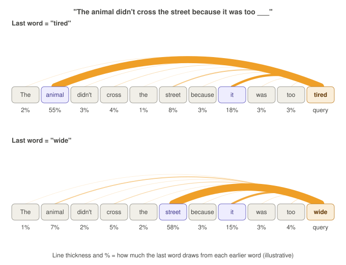

  *Attention: "tired" and "wide" gather from different words*

### Part 2 — Why the last word ends up knowing everything

- One layer = one round of two steps: GATHER (attention: pull from earlier words) and THINK (MLP,
  multi-layer perceptron: process privately; where most stored facts live). Llama 3 8B repeats this
  32 times.
- Stacking compounds: in round 10, a word gathers from words that have already done rounds 1–9.
- ANALOGY: distance-vector routing (RIP, Routing Information Protocol). At each exchange a router
  learns what its neighbors learned last time; after enough exchanges its table reflects the whole
  network. The difference: every word reaches every earlier word in every round, so rounds deepen how
  information is combined rather than extend reach.
- EXAMPLE: "The capital of Italy is ___", following the last word "is" upward (illustrative, not
  literal): layer 1 "I am 'is'" → layer 8 "a name comes next" → layer 20 "capital of Italy" →
  layer 32 "Rome" ready. Lower layers lean toward grammar and surface features, higher layers toward
  meaning and facts — a trend, not a neat division of labor.
- Only the last word's final vector feeds the output head (the Session 2 digest). The other words
  are not wasted: at every layer they supply the K and V the last word reads.
- Then the loop repeats: "Rome" is appended and becomes the new last word.
- Figure:

  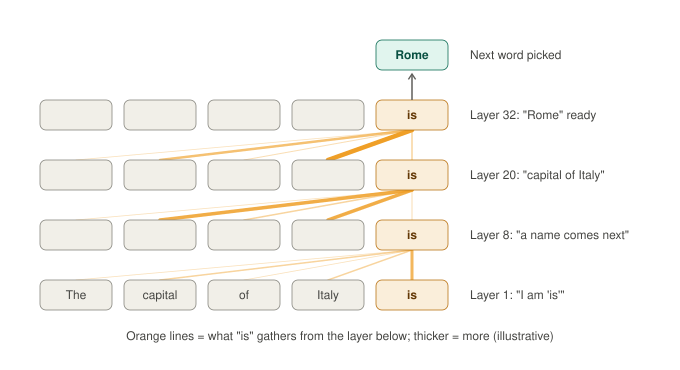

  *Why the last word ends up knowing everything*

**Part 2 Q&A:**

- "Why 64 vectors per word?" At each layer each word stores 2 vectors: a Key and a Value. They differ
  per layer (each layer has its own recipe, W_k and W_v, and the word itself has changed by then).
  32 layers × 2 = 64.
- "So one key is one vector and the value is another?" Yes. Per word per layer: 3 vectors are made
  (Q, K, V), 2 are kept (K, V), 1 is thrown away (Q) — no later word needs an earlier word's question.
- "How is 128 KB per token derived?" 64 vectors × 1,024 numbers × 2 bytes (16-bit) = 131,072 B =
  128 KB (1 KB = 1,024 B). Scale: a 2,000-word conversation (~2,600 tokens) ≈ 330 MB, which is why
  cache memory caps how many users a GPU can serve.
- "Why 4,096 numbers per vector, but only 1,024 for K and V?" 4,096 is the model's WIDTH (d_model), a
  designer's choice. K and V are narrower because of GQA (grouped-query attention, Part 3): Llama 3
  8B keeps only 8 sets of K/V (8 × 128 = 1,024 numbers), each shared by 4 of the 32 query heads.
  Llama 3 70B: width 8,192, but K/V are still 1,024 each.
  General formula: cache per word = layers × 2 × (K/V width) × bytes per number.
- "The designer picks how many numbers describe a vector?" Yes. Note the wording: the 4,096 numbers
  are in the VECTOR (one list, like one spreadsheet row); a MATRIX is the grid of learned weights that
  turns one vector into another. The designer fixes the width, the number of layers (32) and the
  vocabulary (128,256) before training; these fix every matrix's shape and so the 8B parameter count.
  Training decides what the numbers mean and what the weights are ("the designer builds an empty rack
  of a given size; training stocks it"). Trade-off: wider = more capacity, but parameters grow with
  the SQUARE of the width (2× width ≈ 4× per-layer cost). 8B: 4,096 wide × 32 layers; 70B: 8,192 wide
  × 80 layers.

### Part 3 — Many heads, many questions at once

- Problem: one lookup asks one question, but a word needs several answers at once.
- Fix: several lookups in parallel, each with its own question = HEADS. Llama 3 8B: 32 heads per layer.
- ANALOGY: a router runs several tables in parallel on the same packet — FIB (forwarding information
  base) by destination: where to?; ACL (access control list) by 5-tuple: allowed?; QoS (quality of
  service) by DSCP (Differentiated Services Code Point): how urgent? — and combines the answers into
  one forwarding decision.
- EXAMPLE: "The animal crossed the street because it was tired", word "tired":
  head A "who is being described?" → animal; head B "what word came just before me?" → was;
  head C "what action happened?" → crossed. The labels are illustrative: heads are not assigned jobs;
  they learn their own questions. Some are clean (previous-word heads really exist); many are not
  human-readable.
- Same width, split up: 4,096 = 32 heads × 128 numbers. Splitting adds no cost.
- Merged afterward: the 32 answers are placed end to end and blended by one more learned matrix,
  O (output), into a single update for the word.
- 32 layers × 32 heads = 1,024 separate questions per word.
- GQA (grouped-query attention): each head keeps its own question (Q), but heads in a group share one
  K and V. Llama 3 8B: 32 questions per layer, but only 8 K/V sets, each shared by 4 heads → varied
  questions, a 4× smaller cache.
- Figure:

  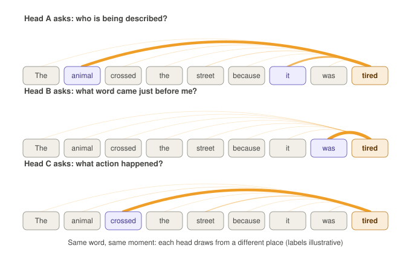

  *Three heads ask three different questions*

### Part 4 — Word order: "dog bites man" vs. "man bites dog"

- Problem: matching is by content only. With the same three words, "bites" would score "dog" and
  "man" identically in both sentences. Position must be injected.
- Fix: RoPE (rotary position embedding). Each word's question and label are rotated by an angle
  proportional to its position, like a clock hand advancing a fixed step per word (illustration: 0°,
  40°, 80°, ...).
- ANALOGY (EE): phasors. The match depends on the ANGLE BETWEEN the two hands, which depends only on
  how far apart the words are, not where they sit — like mixing two signals, where the result depends
  on their phase difference.
- Relative, not absolute: a phrase scores the same at the start of a document or on page 10.
- Many hands at different speeds: each head's 128 numbers form 64 pairs, each a hand turning at its
  own rate. Fast hands (a second hand) separate positions 1 and 2; slow hands (an hour hand) separate
  100 and 2,000.
- Only Q and K are rotated, not V: position decides WHO gets picked, not WHAT they hand over.
- Context-window link (Session 0): Llama 3 8B was trained on angles for positions up to 8,192; beyond
  that is unseen territory, the soft "edge of the map". Long-context versions stretch it — Llama 3.1
  reaches 128K — roughly by slowing the clock plus brief retraining.
- Figure:

  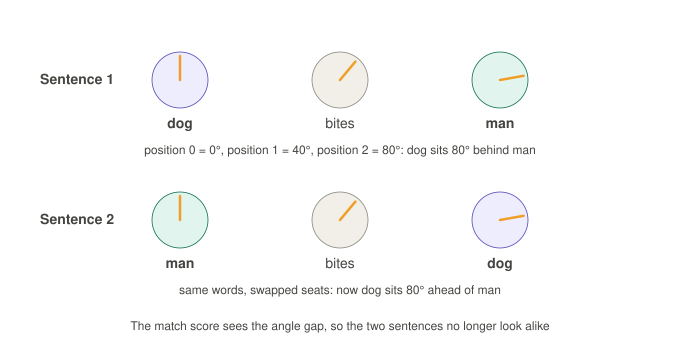

  *RoPE: word order via rotating clock hands*

**Precision note:** it is not "each word asks a question" (one per word). Each word asks 32
questions per layer, one per head.

**Analogies used:** soft lookup table (attention), distance-vector routing (layer stacking), parallel
FIB/ACL/QoS tables (heads), phasors / clock hands (RoPE).

---

## SESSION 4 — Where the weights come from: training, post-training, making models smaller

**The whole session in four lines:**

1. **Pretraining** writes the weights: hide the next word, guess, grade the guess, nudge every weight
   slightly toward a better guess — over trillions of words. Expensive once, then read cheaply forever.
2. **Post-training** (SFT, RLHF and relatives) turns a document-continuer into an assistant. It mostly
   reshapes behavior; the knowledge came from pretraining.
3. **Making models smaller:** distillation cuts the number of knobs (a small student copies a big
   teacher's full probability spread); rounding to 4-bit cuts the bytes per knob; QAT makes the
   rounded model nearly as good as the original.
4. **Wrap-up:** greedy decoding loops because copying is a learned habit and each repeat makes the next
   one likelier; sampling breaks the loop. Plus a one-page map of Sessions 0–4.

### Part 1 — Pretraining: where the weights come from

- The loop (fig 1): a text sample with the next word hidden → the model guesses (a probability spread
  over the vocabulary — the same forward pass as inference) → grade against the real word → backward
  pass → nudge every weight a tiny step → repeat over trillions of words.
- Self-supervised: the text grades itself (each word is the answer key for the words before it), so no
  human labels are needed. That is why the whole internet is usable as training data.
- Training is shaped like PREFILL, not decode: the real text is already known, so a 4,000-token
  document is 4,000 guesses graded in one parallel pass.
- ANALOGY: BGP (Border Gateway Protocol) convergence vs. FIB (Forwarding Information Base) lookup.
  Pretraining = the control plane doing slow, expensive, global work once to write the table;
  inference = the forwarding plane reading it per packet. Like a FIB, the weights are frozen while
  forwarding: the model does NOT learn from your chat (anything "learned" in a conversation lives in
  the context window / KV cache and is gone when the chat ends). Where the analogy breaks: BGP
  converges to a correct table; pretraining only converges to a good statistical average.
- Figure:

  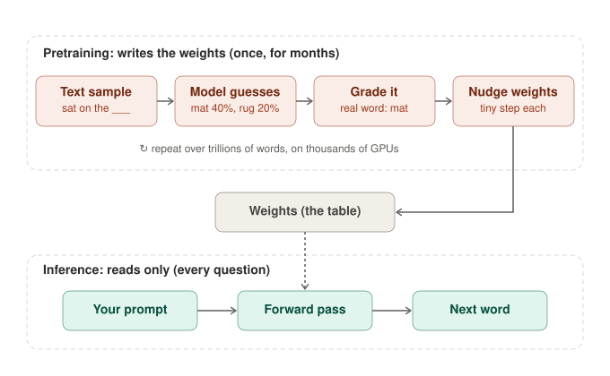

  *Pretraining writes the weights; inference only reads them*

**The grade (loss):**

- Loss = −log₂(probability the model gave the real word) = bits of SURPRISE (fig 2).
  40% on "mat" → 1.3 bits; 0.1% → ~10 bits. Certain and right = 0; confident and wrong → unbounded.
  Each halving of p adds 1 bit.
- What a "bit" means here: a guessing game of yes/no questions. n bits ≈ choosing among 2ⁿ equally
  likely words (1 bit = 2 options, 10 bits ≈ 1,000). This 2^bits figure is called PERPLEXITY.
- Typical value: a good 8B–70B model on web text averages ~1.5–1.8 nats per token (nat = the natural-log
  unit; 1 nat ≈ 1.44 bits) ≈ 2–2.6 bits ≈ choosing among ~4–6 likely tokens out of the whole
  vocabulary. It varies by text: code and boilerplate are low, poetry and names high.
- Loss = compression: driving an entropy coder (Huffman/arithmetic) with the model would encode text
  at about its loss in bits per token. Lower loss = better model = better compressor.
- Why −log and not something simpler: it is a PROPER SCORING RULE — the lowest average penalty comes
  from predicting the true frequencies (honest probabilities). Overconfidence is hammered.
- The size of the correction scales with the miss: the push to raise the right word is ∝ (1 − p)
  (0.6 at p = 40%, 0.999 at p = 0.1%). Probabilities sum to 100%, so raising "mat" lowers the rest.
- Figure:

  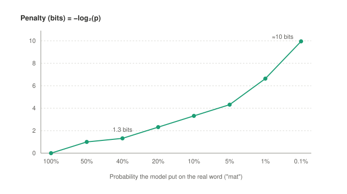

  *The penalty (loss) in bits vs. the probability given to the real word*

**The backward pass (backpropagation) — the amplifier-chain toy (fig 3):**

- Setup: input 1 → stage gains ×2, ×3, ×0.5 → output 3; target 4.
- Each number on the backward side answers ONE question: "if I nudge this up a little, how much does
  the final output move?" — a SENSITIVITY. The standard name for a weight's sensitivity of the loss is
  its GRADIENT; working out which of billions of weights was responsible for an error is called
  CREDIT ASSIGNMENT (informally: assigning blame).
- Checked by direct wiggling: stage 3's gain 0.5 → 0.6 moves the output 3.0 → 3.6, so its sensitivity
  is 6 (= the signal it scales). A signal entering stage 3, 6 → 7, moves the output by 0.5 (= stage
  3's gain): that 0.5 is what is "passed upstream".
- The rule, per stage:
    knob gradient   = (sensitivity arriving from downstream) × (the input this stage received)
    passed upstream = (sensitivity arriving from downstream) × (this stage's own gain)
  Equivalently, knob gradient = its input × the product of ALL gains after it. Results: stage 3 = 6,
  stage 2 = 0.5 × 2 = 1, stage 1 = 1.5 × 1 = 1.5.
- Common mistake: assuming a stage's own gain sets its sensitivity. It does not — stage 3 has the
  smallest gain (0.5) but the largest sensitivity (6). What matters is how big a signal the knob
  scales and how much of its effect survives the stages after it.
- Note: the starting "1" at the output is the output's sensitivity to itself, not "the output should
  go up". Direction enters only at the update: error = 4 − 3 = +1, and each gain moves by
  step × error × sensitivity. With step 0.02: gains → 2.03, 3.02, 0.62; new output ≈ 3.80 (closer to
  4). The most sensitive knob moved most.
- Why go backward: wiggling each knob separately would need one forward pass per weight (8 billion per
  step). The reverse sweep builds "gain from here to the output" one multiply per stage, reusing work,
  so every gradient comes out of ONE sweep.
- EE link: this is sensitivity analysis done in one reverse sweep (cf. the adjoint-network method).
- Figure:

  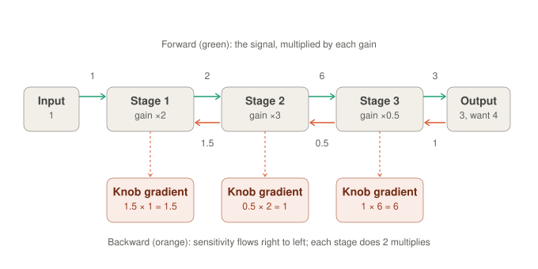

  *Backpropagation through a three-stage amplifier chain*

**Cost and memory:**

- Compute per token: inference ~2 FLOPs per parameter (forward); training ~6 (forward 2 + backward 4,
  because the backward pass does 2 multiplies per stage vs. 1 forward). A training step ≈ 3× an
  inference pass.
- Worked example: Llama 3 8B trained on ~15 trillion tokens ≈ 6 × 8×10⁹ × 15×10¹² ≈ 7×10²³ FLOPs;
  a 500-token answer ≈ 2 × 8×10⁹ × 500 = 8×10¹². One training run ≈ 90 billion answers' worth of
  compute. Frontier scale: Meta's model card reports ~31M GPU-hours for Llama 3.1 405B (~$60M at an
  assumed $2 per GPU-hour). One API answer ≈ a tenth of a cent. Paid once, shared by every user.
- Memory. Correct intuition: the stage inputs (ACTIVATIONS) must be kept until the backward sweep
  reaches them. Common mistake: concluding that training therefore needs ~2× inference memory.
  - Activations scale with batch × sequence length × layers × width, not with parameter count.
  - The bigger fixed extra is per-parameter state that inference never needs: 16-bit weights 2 B +
    FP32 master copy 4 B + gradients 2–4 B + the Adam optimizer's two running averages 8 B ≈ 16 bytes
    per parameter (8B: ~128 GB) vs. ~2 bytes per parameter for inference (8B: ~16 GB + KV cache).
    ≈ 8× before activations.
  - Gradients are 2 or 4 bytes depending on the setup: BF16 saves memory; FP32 keeps tiny gradients
    (~10⁻⁸) from rounding to zero, especially when many small batches are summed. Common practice:
    matmuls in BF16, accumulation and updates in FP32 (hence the FP32 master copy).
  - Inference also saves some activations: the KV cache is exactly each layer's K and V.
  - ACTIVATION CHECKPOINTING: save only some layers' inputs and recompute the rest during the backward
    sweep — much less memory for ~1 extra forward pass (a step ≈ 4× an inference pass instead of 3×).

### Part 2 — Post-training: from text predictor to assistant

- Problem: a pretrained (base) model only continues documents. "Explain DNS (Domain Name System)
  briefly." may continue as "Explain DHCP briefly. Explain ARP briefly…" — it knows DNS; it just
  doesn't know it is in a conversation.
- SFT (supervised fine-tuning): tens of thousands to a few million example conversations in the chat
  format (User: … Assistant: …). The same training loop as Part 1 with different data; only the
  assistant's lines are graded. Teaches the role and the format.
- RLHF (reinforcement learning from human feedback): the model writes 2+ answers; people pick the
  better one; those picks train a REWARD MODEL (a scorer); the model is then nudged toward answers the
  scorer rates higher. Judging is easier than writing.
- ANALOGY: route maps / local-preference. Pretraining built the routing table; post-training mostly
  chooses among routes that already exist. KEY POINT: almost all knowledge comes from pretraining;
  post-training shapes behavior and has classically used a few percent of the compute.
- Optional: DPO (direct preference optimization) trains directly on A-vs-B pairs without a separate
  scorer; feedback can also come from AI judges or automatic checks (code passes its tests, a math
  answer is correct) — RL on such checks drives recent "reasoning model" gains and now uses a much
  larger share of compute. Side effect: raters favor agreeable, confident answers, so RLHF can teach
  flattery (sycophancy).
- POST-TRAINING = everything after pretraining: SFT, preference tuning (RLHF / DPO / AI-judged), RL
  with automatic checks, and safety training — usually in several rounds (e.g. Llama 3: multiple
  SFT + DPO rounds). MID-TRAINING (continued pretraining on curated code, math or long documents)
  sometimes sits in between, and unlike post-training it does add knowledge.
- Figure:

  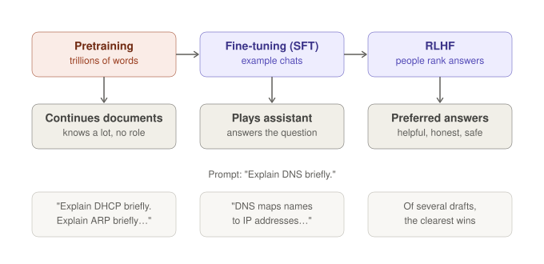

  *Pretraining, supervised fine-tuning (SFT) and RLHF*

### Part 3 — Making models smaller: distillation and QAT

**Distillation:**

- Normal training grades against the ANSWER KEY (mat 100%, everything else 0). Distillation grades the
  student against the TEACHER'S FULL SPREAD (mat 40%, rug 20%, floor 15%, car ~0%): which wrong
  answers were reasonable, which absurd, how sure to be. Much more information per word. Same loop;
  only the target changes.
- ANALOGY: learning from a senior engineer's annotated solutions instead of an answer sheet.
- Limit: fewer knobs can't hold everything the teacher knows; distillation uses the small capacity
  best, but it doesn't remove the limit.
- Figure (distillation is the top half; QAT, the bottom half, is covered below):

  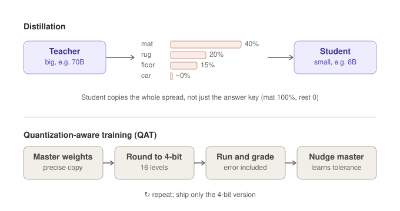

  *Distillation (top) and quantization-aware training (bottom)*

**Quantization vs. QAT:**

- Common mistake: thinking QAT itself reduces the bytes per weight. It does not. ROUNDING to 4-bit
  shrinks the model; QAT only keeps the rounded model smart.
- Job 1, shrink: a ruler with 16 marks (fig 7). Store which mark a weight is nearest — a number 0–15 =
  4 bits — instead of its exact 16-bit value. On a −1..+1 ruler (gap 2/15 ≈ 0.133), 0.31 → mark 10 =
  binary 1010, read back as 0.333. Plus one shared scale per block of ~32 weights. 8B weights:
  ~16 GB → ~4 GB, with or without QAT.
- Check: on a 0..1 ruler (gap 1/15; 0.31 ÷ 0.0667 ≈ 4.65) the same weight would be mark 5 = 0101.
  The figure's ruler spans −1..+1 because weights are both negative and positive; the cost is gaps
  twice as coarse. (Both happen to read back 0.333 here — a coincidence.) Real formats size each
  block's ruler to its largest weight, and many number the marks −8..+7.
- ANALOGY: an image limited to a 16-color palette. PTQ (post-training quantization) = squash a
  finished photo to the palette (banding). QAT = the painter works knowing only 16 colors exist and
  places them so the picture still reads. Same file size; a better picture.
- Job 2, QAT — toy (fig 6): four weights 0.27 / 0.30 / 0.33 / 0.36, inputs 1, precise output 1.26;
  grid step 0.25, boundary 0.375. PTQ: all four round down → 1.00 (the errors pile up one way).
  The QAT loop, step by step (the precise copy nudged ~0.01 per step):
    step 0: rounded 0.25 ×4 → 1.00, error −0.26 → push all up
    step 1: precise 0.28/0.31/0.34/0.37 → still all 0.25 → 1.00 (hidden copy moved; nothing visible)
    step 2: precise 0.29/0.32/0.35/0.38 → last crosses 0.375 → 0.5 → 1.25, error −0.01 → push ≈ 0
  Nobody planned the cancellation: the weight nearest a boundary crossed first, the error vanished, and
  the push stopped. An overshoot would flip the error's sign and push back.
- How QAT "knows": it doesn't; it is the ordinary training loop with ONE change — the forward pass
  uses the rounded weights, so the grade includes the rounding damage. The backward pass runs EVERY
  step (the error sets the size of the nudge, not whether it happens), and it nudges the hidden
  PRECISE master copy, never the 4-bit weights; tiny nudges accumulate there until a weight crosses a
  boundary. Rounding has no useful slope, so the backward pass treats it as absent (the
  STRAIGHT-THROUGH ESTIMATOR). At the end the precise copy is rounded once more and discarded.
- EE ANALOGY: a delta-sigma modulator — a coarse output, an integrator accumulating error, a threshold
  that flips the output, and feedback keeping the average right. Master copy = integrator.
- When: usually LAST, a short phase before shipping a 4-bit version (Gemma 3: ~5,000 steps, using the
  full-precision model's spread as the target = distillation). Only the model's creator can
  realistically do it; most downloadable 4-bit models (community files of open weights) are PTQ.
  Less common: folding it into the final post-training round, or training in low precision from
  scratch (BitNet, weights −1/0/+1).
- Bit widths: 8-bit (256 marks) — PTQ is usually enough; 4-bit (16) — QAT's sweet spot; 2-bit (4) —
  PTQ breaks, so QAT or special methods are needed; ~1.58-bit (3) — must be trained that way from the
  start. Each bit removed halves the marks and doubles the gap. Some labs now pretrain much of a model
  in FP8 (e.g. DeepSeek-V3). Rounding can also cover activations and the KV cache.
- Figures (plus the bottom half of the distillation/QAT figure above):

  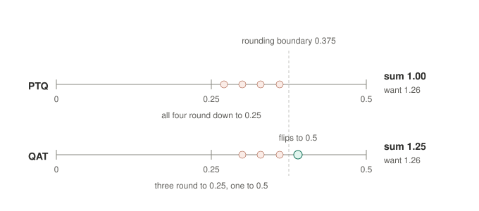

  *Toy example: rounding after training (PTQ) vs. QAT*

  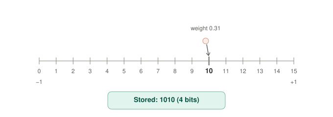

  *A 4-bit ruler with 16 marks*

**The training flows, as one-liners:**

    Teacher:           Pretraining → SFT → RLHF / preference tuning → finished big model
    Plain small model: Pretraining → SFT → RLHF / preference tuning → QAT → ship 4-bit
    Student, option A: distill-pretrain (graded against the teacher's spread) → SFT → RLHF → QAT → ship 4-bit
    Student, option B: normal pretraining → SFT on teacher-written answers → RLHF → QAT → ship 4-bit
    Full small-model recipe: train big teacher → prune → distill-pretrain → SFT → RLHF → QAT → ship 4-bit

  Option A (used for small Gemma 2/3 models and Llama 3.2 1B/3B) needs the teacher's raw
  probabilities, i.e. you own the teacher; option B works from text alone (e.g. via an API).
  Llama 3.2 1B/3B also started by PRUNING the 8B model (removing less-important parts). The teacher
  keeps helping: writing SFT examples, judging in preference tuning, and serving as the target during
  QAT.

### Part 4 — Wrap-up

**4a. Why greedy decoding falls into repetition loops:**

- GREEDY decoding = always take the single most likely next token; no randomness.
- Why it loops (fig 8): (1) copying is a learned habit — attention easily finds an earlier
  "I like cats." and "repeat what followed last time" pays off in real text; (2) each repeat adds
  another copy to the context, making the next repeat likelier (illustratively 30% → 60% → 90%) —
  positive feedback; (3) a deterministic system whose state repeats will repeat forever.
- ANALOGY: a routing loop — two routers' deterministic tables point at each other; nothing inside the
  loop breaks it; you need TTL (time to live).
- The "TTL" options: SAMPLING (roll dice weighted by the probabilities; TEMPERATURE sets how
  adventurous; TOP-P / nucleus sampling rolls only among the tokens covering e.g. 90% of the
  probability, so absurd picks are excluded) — chatbots sample by default; REPETITION / FREQUENCY
  PENALTY (lower the score of already-used tokens); better post-training; MAX TOKENS (the literal TTL:
  stops the output, fixes nothing).
- Even without looping, greedy text reads flat: human writing isn't a chain of each moment's most
  predictable word.
- Figure:

  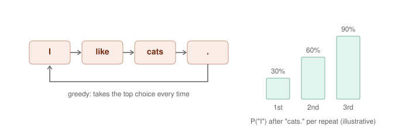

  *Why greedy decoding falls into a repetition loop*

**4b. The whole curriculum on one page** (fig 9):

- S4: a model is built by a next-word guessing loop over trillions of words, shaped into an assistant
  by post-training, and shrunk by distillation and QAT.
- S1: the result is a frozen table of weights — billions of numbers; the model IS that table, not code.
- S2 / S3: answering means pushing tokens through 32 layers of matrix multiplies and attention to get
  odds for the next word.
- S0 / S4: one token is picked (sampling avoids greedy's loops), appended, and the loop repeats.
- S2: every step is limited by GPU memory bandwidth, hence the KV cache and quantization.
- Figure:

  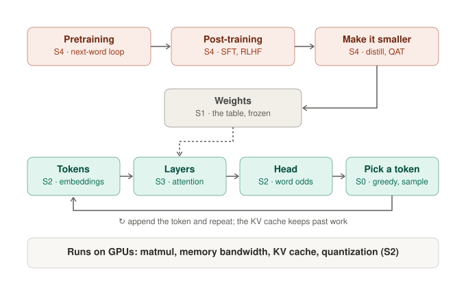

  *The whole curriculum on one page, Sessions 0–4*

### Recap Q&A

**"How do embedding, attention and head work? Is a head (token lookup) run at each layer on each
token?"** (fig 10)

- Two different things are both called "head":
  - ATTENTION HEADS (Session 3): inside every layer, 32 per layer × 32 layers; they gather context.
  - OUTPUT HEAD (Session 2): once, after the last layer, on the last position; turns its vector into
    one score per vocabulary word (128,256 scores).
- The token lookup (EMBEDDING) happens ONCE, at the start: token ID → a row of 4,096 numbers
  (coordinates in meaning space; the Vivaldi-coordinates analogy). Layers never look tokens up again;
  they refine those vectors.
- Each layer: ATTENTION (gather — a soft lookup over other words; 32 heads = 32 questions in parallel,
  like parallel FIB/ACL/QoS tables) then the MLP (think — each word processed alone).
- After 32 rounds, the last word's vector summarizes everything relevant → output head (a bank of
  matched filters against every vocabulary word) → probabilities → pick → append → repeat for the new
  token only (earlier tokens' K and V are in the KV cache).
- The correct part of that intuition: every token does go through every layer (all at once in
  prefill; only the new token in decode).
- Figure:

  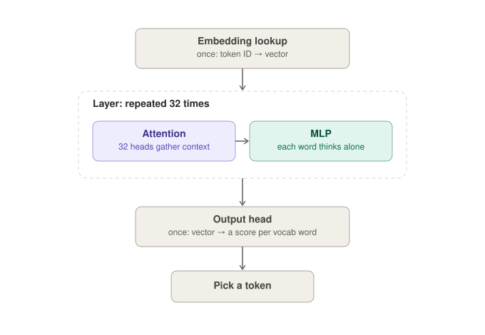

  *Embedding lookup, layers with attention heads, and the output head*

**"What does the MLP do?"** (fig 11)

- A big bank of "if you see this pattern, add that fact" rules, applied to each word separately.
- EXAMPLE: "The Eiffel Tower is in ___". After attention, the last word's vector knows the subject is
  the Eiffel Tower. The MLP then:
  1. CHECK — compare the 4,096-number vector against 14,336 detectors in one matmul; each detector is
     a matched filter for a pattern.
  2. GATE — only strong matches pass (the classic gate, ReLU, is a rectifier: an ideal diode). This is
     what makes each rule an "if".
  3. WRITE BACK — each detector that fired adds its stored pattern ("Paris / France") into the vector;
     a second matmul shrinks back to 4,096. The result is ADDED, not swapped in.
  The output head then scores "Paris" high. Fact-tracing research finds that recall like this happens
  mainly in MLP layers.
- ANALOGY: an ACL table — thousands of match → action rules, all checked in parallel.
- Attention vs. MLP: attention moves information BETWEEN words (a meeting); the MLP uses it WITHIN each
  word (thinking at your own desk) — Session 3's "gather then think".
- MLPs hold most of the weights: 3 × 4,096 × 14,336 ≈ 176M per layer × 32 ≈ 5.6B of 8B (~70%).
  Optional: Llama-type models use SwiGLU (Swish-gated linear unit), a smoother gate with a third
  matrix — the same check / gate / write-back idea.
- Figure:

  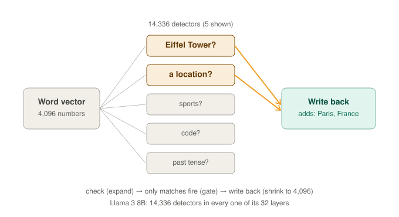

  *The MLP as a bank of pattern detectors*

**"What do prefill and decode each do?"** (fig 12)

- PREFILL: the whole prompt goes through all layers in ONE parallel pass; it fills the KV cache and
  produces the first answer token. One weight read serves many tokens, so it is compute-bound for LONG
  prompts (past ~300 tokens on an H100; a short prompt still costs one full weight stream — see
  Session 2, part 4). You feel it as TTFT (time to first token).
- DECODE: one new token per pass; its attention reads earlier tokens from the KV cache, its own K and
  V are appended, the next token is picked; repeat. Bandwidth-bound: every token still streams ALL the
  multiplied weights (~15 GB at 16-bit; on a ~3.35 TB/s GPU ≤ ~220 tokens/s per stream). You feel it as
  streaming speed (tokens/s).
- ANALOGY (Session 2): prefill = a large sliding window; decode = stop-and-wait ARQ (automatic repeat
  request) — each token must finish before the next can start.
- Links to Session 4: training is prefill-shaped; 4-bit weights ≈ 4× faster decode (¼ of the bytes).
- Figure:

  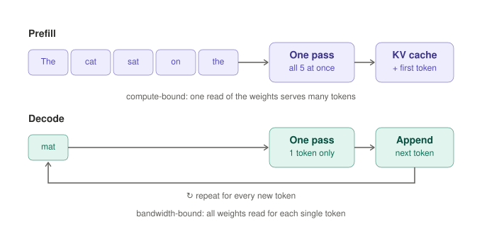

  *Prefill vs. decode*

**"When I type a 20-word question, is it all prefilled, then decode generates the 1st answer token,
then the 2nd, etc.?"** — Almost; three corrections:

1. Prefill itself produces answer token 1 (the output head runs on the last prompt position at the
   end of prefill). Decode starts with token 2.
2. What is prefilled is the WHOLE CONTEXT, not just your words: the hidden system prompt, chat-template
   markers, earlier turns, tool results and attachments, then your question — counted in tokens
   (20 English words ≈ 25–30 tokens).
3. In a multi-turn chat, systems often keep the earlier turns' KV cache (PROMPT CACHING), so only the
   new part is prefilled; without it, the whole conversation is prefilled again on every turn.

  Corrected sequence: prefill the whole context → answer token 1 → decode token 2 → decode token 3 → …
  until an end-of-answer token or the length limit.

**Analogies used:** BGP convergence vs. FIB lookup (training vs. inference), amplifier-chain
sensitivity (backprop), route maps / local-pref (post-training), annotated solutions vs. answer sheet
(distillation), 16-color palette (quantization vs. QAT), delta-sigma modulator (QAT feedback), routing
loop + TTL (greedy repetition), ACL rule table (MLP), stop-and-wait ARQ vs. sliding window (decode vs.
prefill).
